# TP v2 : Attribution des interfaces et des adresses IP, configuration de base Cisco

###### tags: `GIT` `Satom` `GNS3` `Cisco` `TP` `FastEthernet` `SSH` `MobaXterm`

> **Geneva Institute of Technology · CFC informaticien · Cours réseau**
> Étudiant : **Paul Giocanti** · Énoncé : [TP v2 configuration de base Cisco](https://hackmd.io/@Formateur/HkrYKYbJml)
> Projet GNS3 : `TP_v2_GiocantiPaul.gns3` · Console : MobaXterm (imposée)

---

## Sommaire

1. [Contexte et objectif](#1-Contexte-et-objectif)
2. [Environnement et écarts avec l'énoncé](#2-Environnement-et-écarts-avec-lénoncé)
3. [Topologie et plan d'adressage réalisés](#3-Topologie-et-plan-dadressage-réalisés)
4. [Étapes 1 à 11 : réalisation, preuves et réponses](#4-Étapes-1-à-11--réalisation-preuves-et-réponses)
5. [Problèmes rencontrés](#5-Problèmes-rencontrés)
6. [Tableau de validation](#6-Tableau-de-validation)
7. [Livrables](#7-Livrables)

---

## 1. Contexte et objectif

On construit un petit réseau d'entreprise de 6 équipements Cisco dans GNS3 : 4 routeurs (R1 à R4) et 2 switches (SW1, SW2) sur un même réseau local `192.168.10.0/24`. R1 sert de passerelle pour tout le monde.

Le but est de savoir faire la **configuration de base** qu'on retrouve sur tout équipement neuf en entreprise, puis de **prouver** que chaque réglage fonctionne avec les commandes `show` :

- identité de l'équipement : nom, domaine, bannière d'avertissement ;
- adresses IP et passerelle ;
- sécurité des accès : mots de passe, compte nominatif `admin`, déconnexion automatique ;
- administration à distance en **SSH v2 uniquement** (Telnet et web coupés) ;
- ports des switches : accès, trunk 802.1Q, ports inutilisés éteints ;
- sauvegarde et annulation d'une commande.

> 💡 **Méthode de travail retenue pour tout le TP.** Pour chaque étape : 1) je regarde l'état avant ; 2) je configure ; 3) je vérifie avec une commande `show` ; 4) je ne passe à l'étape suivante que si la vérification est bonne. Le **prompt** indique toujours où l'on est : `R1>` (utilisateur), `R1#` (privilégié, pour les `show`), `R1(config)#` (configuration globale), `R1(config-if)#` (configuration d'une interface).

---

## 2. Environnement et écarts avec l'énoncé

| Élément | Énoncé | Réalisé | Pourquoi |
|---|---|---|---|
| Logiciel | GNS3 | GNS3 2.2.61 sous Windows, moteur Dynamips | Conforme |
| Console | non précisé | **MobaXterm** Home Edition 26.6 | Outil imposé par le formateur |
| Routeurs | c7206, `FastEthernet0/0` | c7200 (`c7200-adventerprisek9-mz.152-4.S71`) ; carte du slot 0 passée en **C7200-IO-FE** sur R1 à R4 | Le modèle de routeur réglé en cours a un slot 0 `C7200-IO-GE-E` (→ `GigabitEthernet0/0`). Pour avoir le `FastEthernet0/0` de l'énoncé, j'ai changé uniquement le slot 0, nœud par nœud, sans toucher au modèle du formateur. Les autres cartes du modèle restent présentes (visibles sur la capture 01). |
| Switches | vIOS-L2 | **EtherSwitch c3725 + module NM-16ESW** (`c3725-adventerprisek9-mz.124-15.T14`) | Seules les images c3725 et c7200 sont fournies par le formateur (Teams « IOS for GN3 »). vIOS-L2 demanderait en plus la GNS3 VM. C'est aussi le matériel de l'exemple donné par le formateur. |
| Ports des switches | `Gi0/1`, `Gi0/2`, `Gi0/15`, `Gi0/3-14` | **`Fa1/1`, `Fa1/2`, `Fa1/15`**, `Fa1/3-14` éteints, **`Fa1/0` éteint en plus** | Le NM-16ESW n'a que des ports `FastEthernet1/0` à `1/15`. J'ai gardé les **mêmes numéros** que l'énoncé pour rester lisible. `Fa1/0` existe aussi ici et n'est pas utilisé : je l'ai éteint comme les autres ports libres. |
| Descriptions des interfaces | `LAN vers SW1 Gi0/1 (L1)`… | Texte de l'énoncé recopié tel quel | Le texte demandé est conservé ; le port physique réel est `Fa1/x` (voir tableau 3.1). |
| Trunk | `switchport mode trunk` | idem ; vérification avec `show interfaces FastEthernet1/15 trunk` | Sur cet IOS, `show interfaces trunk` (sans interface) ne renvoie rien ; la variante par interface affiche bien le trunk. Le NM-16ESW ne fait que du 802.1Q : `switchport trunk encapsulation dot1q` n'est pas nécessaire. |
| Ligne console | `login local`, `exec-timeout 10 30` | idem, plus `privilege level 15` hérité | La configuration de départ fournie par GNS3 contient `privilege level 15` sur `line con 0` : il est resté, sans gêner la demande de l'énoncé (l'authentification `admin` est bien exigée). |
| Bannière exec des switches | — | `banner exec` de GNS3 encore présente sur SW1/SW2 | Bannière d'information d'origine de l'image EtherSwitch, laissée en place ; notre `banner motd` s'affiche avant. |

---

## 3. Topologie et plan d'adressage réalisés

### 3.1 Câblage

| N° | Équipement A | Interface A | Équipement B | Interface B (énoncé) | Interface B (réalisé) | Type |
|---|---|---|---|---|---|---|
| L1 | R1 | Fa0/0 | SW1 | Gi0/1 | **Fa1/1** | Accès |
| L2 | R2 | Fa0/0 | SW1 | Gi0/2 | **Fa1/2** | Accès |
| L3 | R3 | Fa0/0 | SW2 | Gi0/1 | **Fa1/1** | Accès |
| L4 | R4 | Fa0/0 | SW2 | Gi0/2 | **Fa1/2** | Accès |
| L5 | SW1 | Gi0/15 → **Fa1/15** | SW2 | Gi0/15 | **Fa1/15** | Trunk 802.1Q |

Pour démarrer, on vérifie que la topologie GNS3 correspond au tableau : 6 équipements nommés comme dans l'énoncé, et chaque câble branché sur la bonne prise.

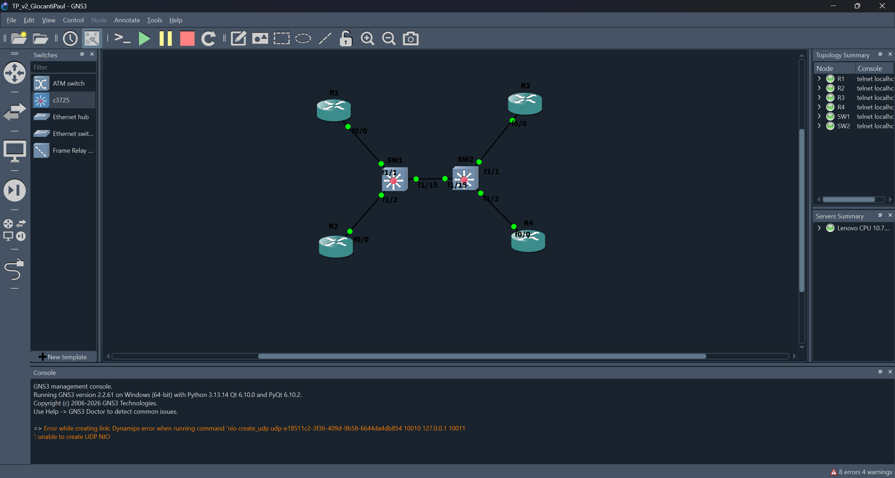

On voit R1 et R2 sur `f1/1` et `f1/2` de SW1, R3 et R4 sur `f1/1` et `f1/2` de SW2, et le lien `f1/15 ↔ f1/15` entre les deux switches. Les 6 nœuds sont verts dans « Topology Summary », donc démarrés. Le message orange en bas (`unable to create UDP NIO`) date de la création d'un câble : GNS3 a réessayé tout seul sur un autre port et le lien est bien créé (voir § 5).

### 3.2 Plan d'adressage

| Équipement | Interface | Adresse IP | Masque | Passerelle |
|---|---|---|---|---|
| R1 | FastEthernet0/0 | 192.168.10.1 | 255.255.255.0 | — (c'est la passerelle) |
| R2 | FastEthernet0/0 | 192.168.10.2 | 255.255.255.0 | route par défaut → 192.168.10.1 |
| R3 | FastEthernet0/0 | 192.168.10.3 | 255.255.255.0 | route par défaut → 192.168.10.1 |
| R4 | FastEthernet0/0 | 192.168.10.4 | 255.255.255.0 | route par défaut → 192.168.10.1 |
| SW1 | Vlan1 | 192.168.10.11 | 255.255.255.0 | `ip default-gateway 192.168.10.1` |
| SW2 | Vlan1 | 192.168.10.12 | 255.255.255.0 | `ip default-gateway 192.168.10.1` |

Domaine : `git.satom.ch`. Mots de passe : un mot de passe choisi, non publié, conforme à la règle de l'énoncé (12 caractères minimum, majuscules, minuscules, chiffres et symbole).

---

## 4. Étapes 1 à 11 : réalisation, preuves et réponses

### Étape 1 : Démarrage et vérification des interfaces (2 pts)

Avant de configurer quoi que ce soit, l'énoncé demande de vérifier le **nom réel** de l'interface LAN, car c'est lui qu'on tapera ensuite dans toutes les commandes. Sur R1 : `enable` puis `show ip interface brief`.

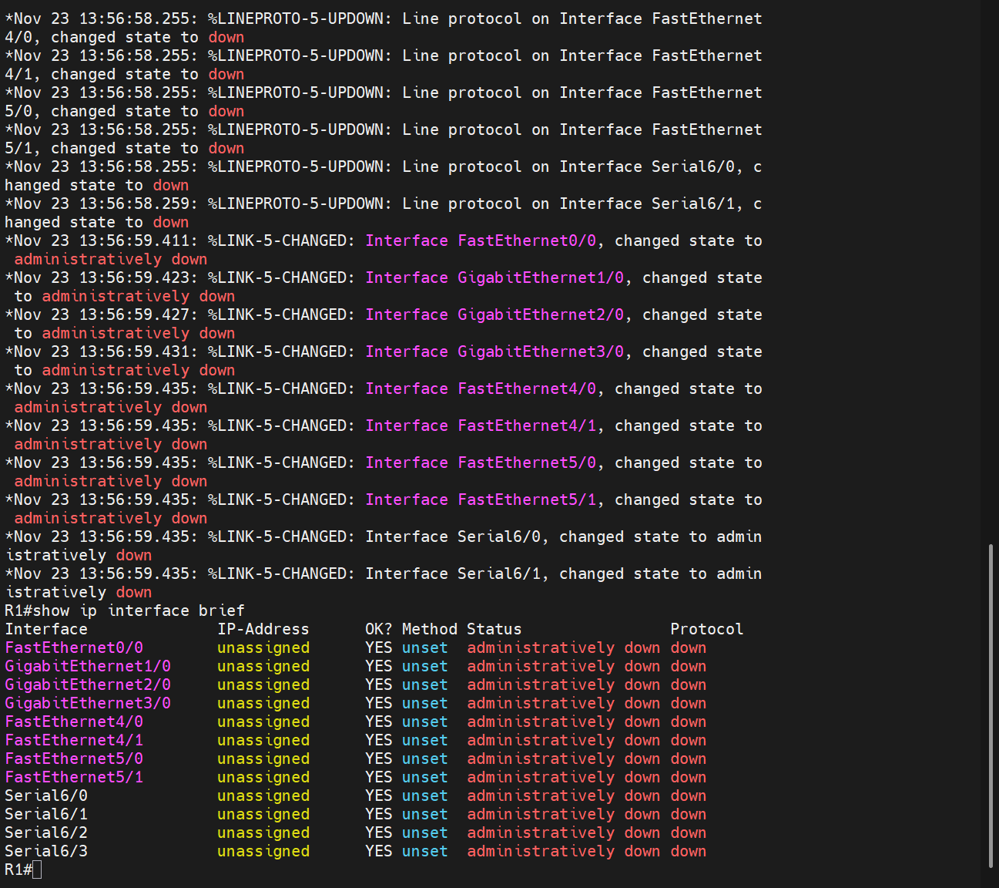

La première ligne est bien **`FastEthernet0/0`**, comme dans l'énoncé (grâce à la carte C7200-IO-FE). Elle n'a pas encore d'adresse (`unassigned`) et elle est `administratively down` : sur un routeur Cisco, les interfaces sont éteintes par défaut. Les autres lignes (`GigabitEthernet1/0`…, `Serial6/x`) sont les cartes du modèle de routeur, non utilisées.

> 💡 **À retenir.** `show ip interface brief` est la première commande à taper sur un équipement inconnu : elle donne en une fois le nom des interfaces, leur IP, leur état administratif (`Status`) et l'état du lien (`Protocol`).

### Étape 2 : Nom, domaine et bannière (3 pts)

Sur les 6 équipements, en mode `configure terminal` : `hostname`, `ip domain-name git.satom.ch`, `no ip domain-lookup` et la bannière `banner motd #…#`.

> 💡 **Bannière : le caractère délimiteur.** Dans `banner motd #`, le `#` ouvre et ferme le texte. Il faut **un espace** entre `motd` et `#` : sans espace (`banner motd#`), IOS prend la première lettre du texte comme délimiteur (voir § 5).
> 💡 **`no ip domain-lookup`** évite qu'une faute de frappe (un mot inconnu) soit prise pour un nom de machine : sans elle, le routeur bloque plusieurs secondes à chercher un serveur DNS.

La vérification demandée filtre la configuration avec `show running-config | include hostname|domain|banner` : le `|` (« pipe ») envoie la sortie dans un filtre qui ne garde que les lignes contenant un des mots.

R1 :
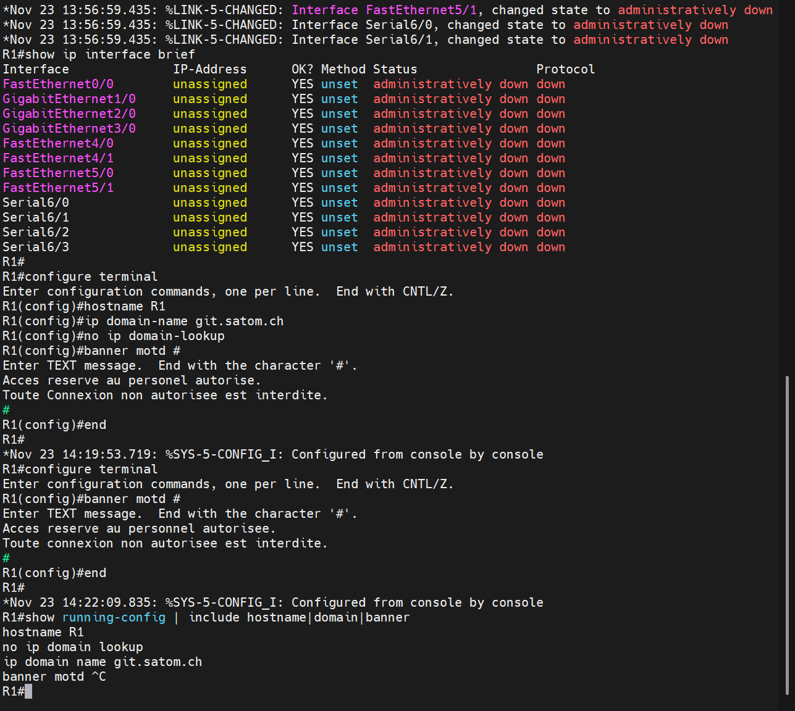

R2 :
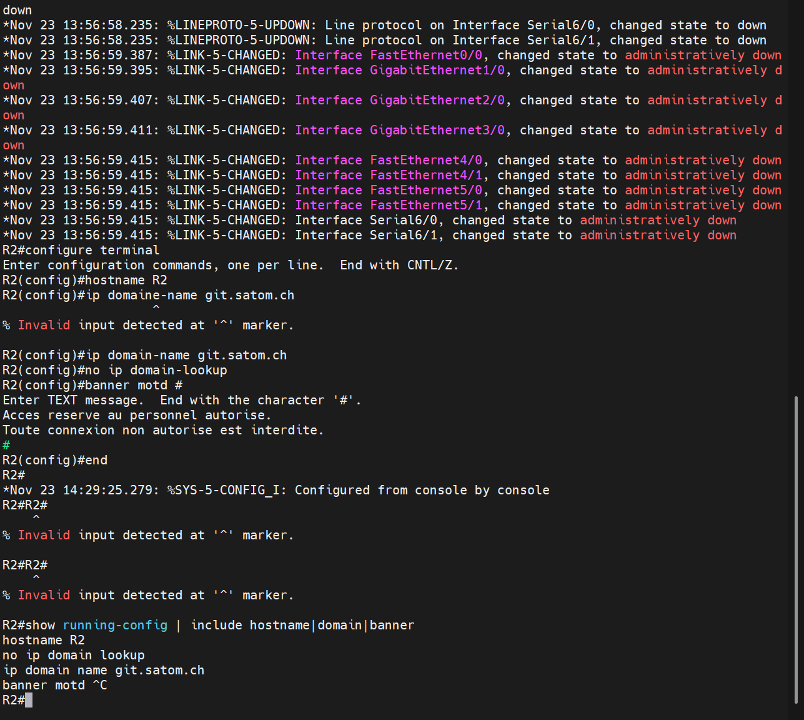

R3 :
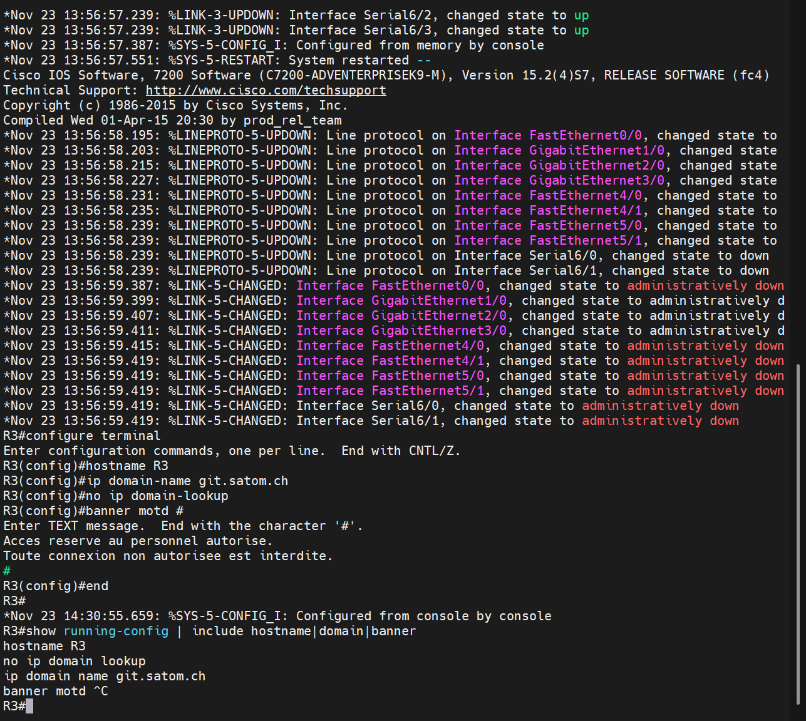

R4 :
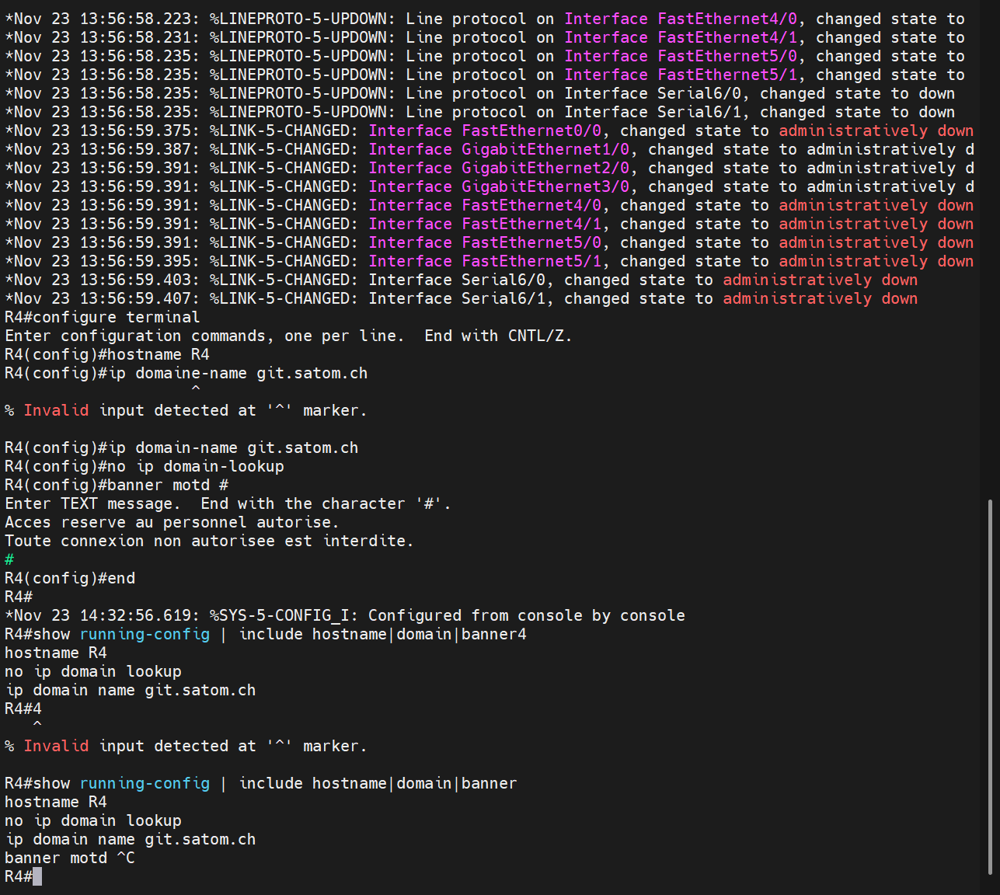

SW1 :
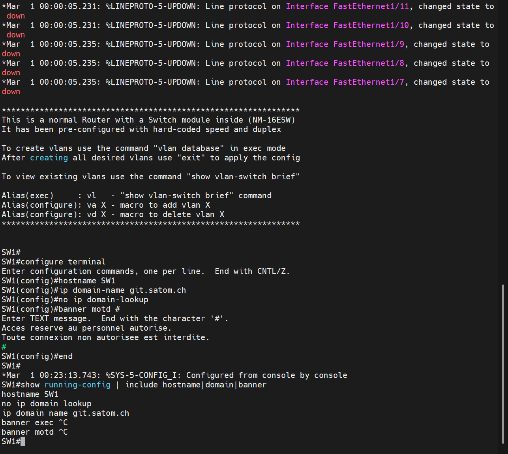

SW2 :
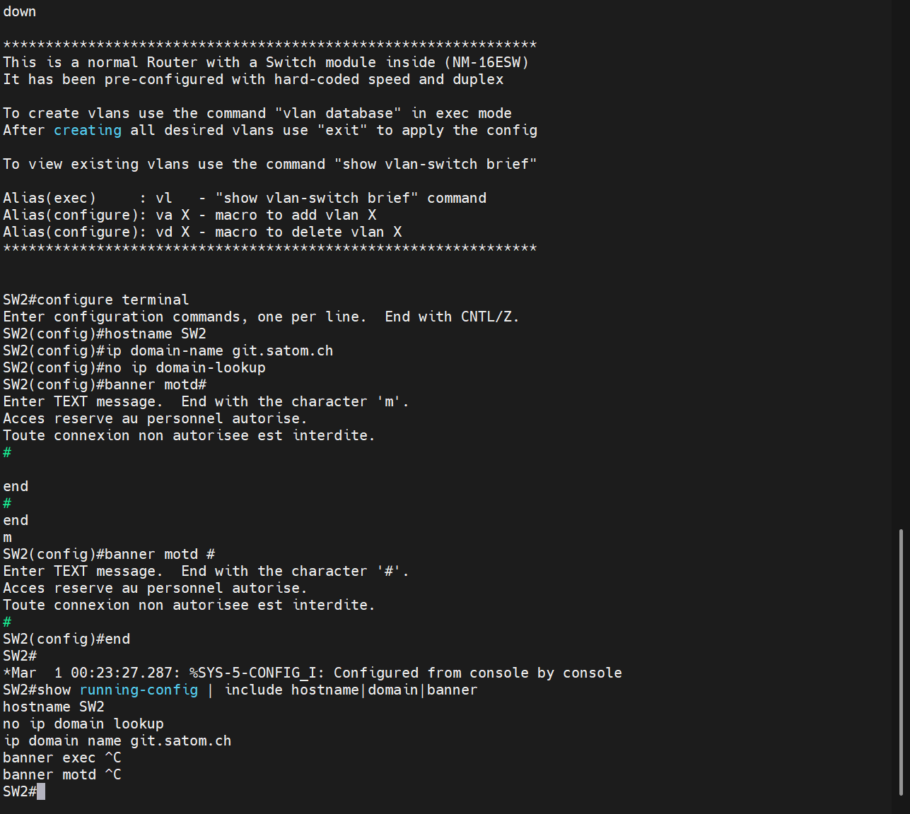

Sur les six captures, on lit `hostname` avec le bon nom, `no ip domain lookup`, `ip domain name git.satom.ch` et `banner motd ^C` (IOS affiche le délimiteur sous la forme `^C`, quel que soit celui qu'on a tapé). Sur SW1 et SW2 apparaît aussi `banner exec ^C` : c'est la bannière d'origine de l'image EtherSwitch (voir § 2). Le texte de la bannière elle-même se voit à la connexion (étape 10, capture 18).

**Question 2.1 : pourquoi `ip domain-name` doit-il être défini avant `crypto key generate rsa` ?**
La clé RSA porte le nom complet de l'équipement, `hostname.domaine` (ici `R1.git.satom.ch`). Sans domaine, IOS refuse de générer la clé et SSH ne peut pas démarrer. C'est pour la même raison qu'on ne peut pas garder le nom par défaut `Router` si on veut SSH.

**Question 2.2 : à quoi sert `no hostname` et quel est son effet sur le prompt ?**
`no hostname` supprime le nom configuré et remet le nom par défaut : le prompt redevient `Router#` (ou `Router(config)#`). Elle sert à annuler une mauvaise saisie. Le prompt affichant le nom, on voit immédiatement le changement.

### Étape 3 : Adressage IP des routeurs (3 pts)

Sur R1 à R4 : `interface FastEthernet0/0`, `description`, `ip address 192.168.10.x 255.255.255.0`, `no shutdown`. On vérifie ensuite R2 avec `show run interface FastEthernet0/0`, qui n'affiche que la partie de configuration de cette interface.

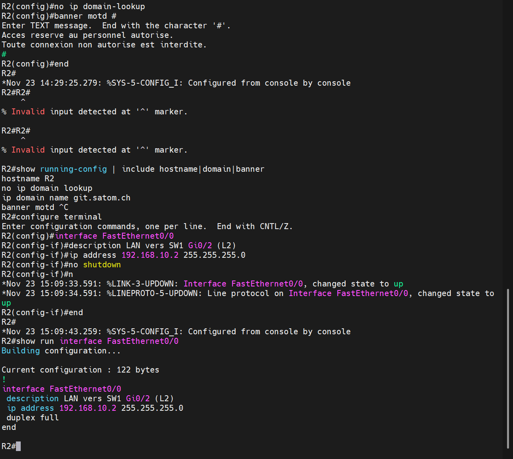

L'interface porte la description `LAN vers SW1 Gi0/2 (L2)` et l'adresse `192.168.10.2 255.255.255.0`. Il n'y a **pas** de ligne `shutdown` : l'interface est donc allumée (dans une configuration Cisco, on ne voit que ce qui diffère du réglage par défaut). `duplex full` vient de la carte FastEthernet.

**Question 3.1 : différence entre `shutdown` et l'absence d'adresse IP ?**
`shutdown` éteint l'interface : plus aucun trafic ne passe, son état devient `administratively down`. Une interface allumée **sans adresse IP** est `up/up` (le câble fonctionne) mais le routeur ne peut pas y envoyer ou recevoir de paquets IP : il n'a pas d'identité sur ce réseau. Dans le premier cas c'est « la porte est fermée », dans le second « la porte est ouverte mais il n'y a pas de numéro sur la maison ».

### Étape 4 : Adressage IP des switches (2 pts)

Un switch de niveau 2 n'a pas d'IP sur ses ports : on lui en donne une sur l'**interface virtuelle `Vlan1`**, uniquement pour pouvoir l'administrer à distance. Sur SW1 : `interface Vlan1`, `description Gestion SW1`, `ip address 192.168.10.11 255.255.255.0`, `no shutdown`, puis `ip default-gateway 192.168.10.1`. Même chose sur SW2 avec `.12`.

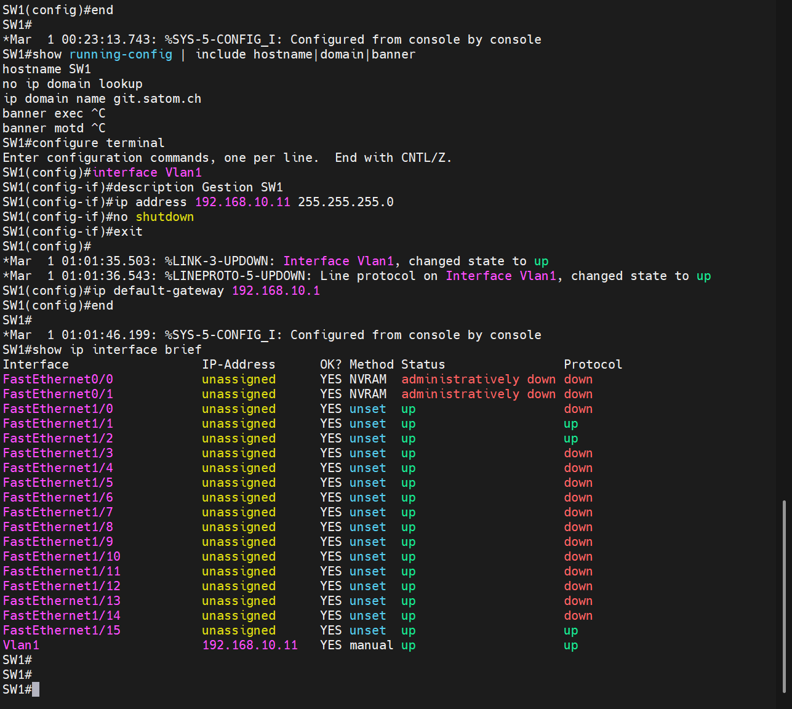

On voit les commandes tapées, puis les messages `Interface Vlan1, changed state to up`. Dans `show ip interface brief`, `Vlan1` a l'adresse `192.168.10.11` en `up/up`. Les ports `Fa1/1`, `Fa1/2` (routeurs) et `Fa1/15` (lien vers SW2) sont `up/up` : ce sont les seuls câblés.

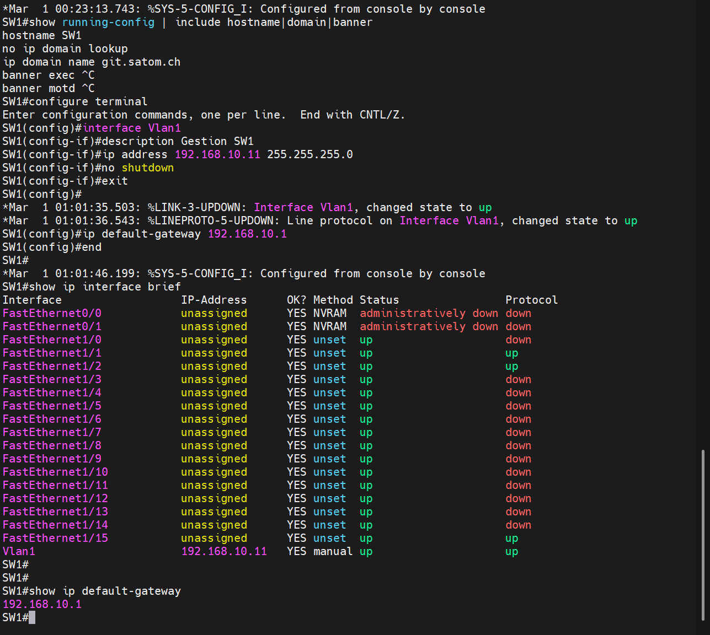

`show ip default-gateway` répond `192.168.10.1` : SW1 sait à qui envoyer ce qui ne concerne pas son propre réseau.

**Question 4.1 : pourquoi `ip default-gateway` sur un switch et pas sur R1 ?**
Le switch fonctionne en mode niveau 2 (`no ip routing` dans sa configuration de départ) : il n'a pas de table de routage. Pour répondre à un administrateur situé sur un autre réseau, il a besoin qu'on lui indique une passerelle. R1, lui, **est** un routeur : il a une table de routage et il est lui-même la passerelle du LAN, il n'a donc pas besoin qu'on lui en indique une.

### Étape 5 : Passerelle par défaut de R2, R3 et R4 (2 pts)

Sur R2, R3 et R4 (pas R1) : `ip route 0.0.0.0 0.0.0.0 192.168.10.1`. Vérification sur R3 avec `show run | include ip route`.

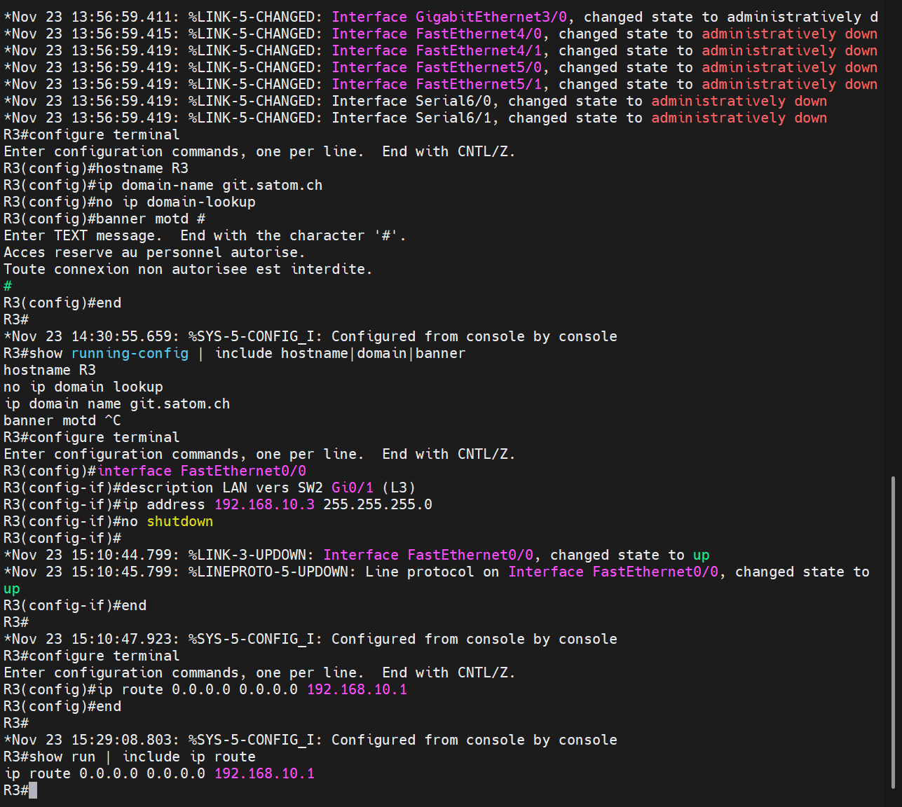

La ligne `ip route 0.0.0.0 0.0.0.0 192.168.10.1` est présente dans la configuration de R3.

**Question 5.1 : que signifie `0.0.0.0 0.0.0.0` ? Quel trafic l'emprunte ?**
C'est la **route par défaut**. Le masque `0.0.0.0` ne compare aucun bit : toutes les adresses correspondent. Le routeur l'utilise pour tout paquet dont la destination ne correspond à **aucune route plus précise** de sa table, et l'envoie à `192.168.10.1` (R1). C'est la « sortie vers le reste du monde ».

### Étape 6 : Connectivité (2 pts)

Depuis R2, on teste les cinq autres équipements avec `ping`.

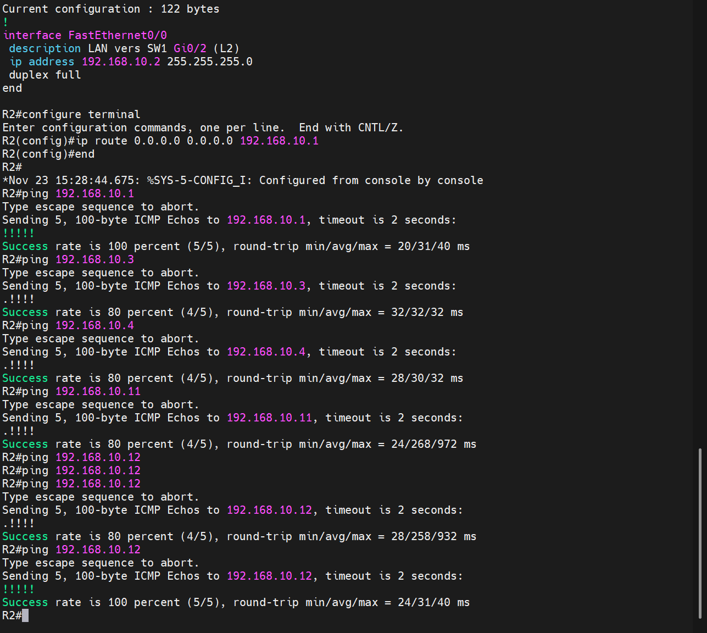

Les cinq destinations répondent. Le dernier ping vers SW2 (`192.168.10.12`) affiche `!!!!!`, soit 100 % de réussite. Les premiers essais vers `.3`, `.4`, `.11` et `.12` commencent par un `.` (80 %) : c'est normal, le tout premier paquet est perdu le temps que R2 apprenne l'adresse MAC de la destination (requête **ARP**). Relancé, le ping répond `!!!!!`.

> 💡 **Lire un ping Cisco.** `!` = réponse reçue, `.` = pas de réponse dans le délai. Un seul `.` au début, puis des `!`, signifie presque toujours ARP, pas une panne.

### Étape 7 : Mots de passe et lignes d'accès (3 pts)

Sur les 6 équipements : `service password-encryption`, `enable secret`, `username admin privilege 15 secret`, puis sur `line con 0` et `line vty 0 4` : `password`, `login local`, `exec-timeout 10 30`, `logging synchronous`, et `transport input ssh` sur les VTY.

> 💡 **Vocabulaire.** **Console** (`line con 0`) = le câble branché directement sur l'équipement. **VTY** (`line vty 0 4`) = les 5 « prises virtuelles » utilisées par les connexions à distance (SSH). `login local` = demander un **nom d'utilisateur + mot de passe** pris dans la liste locale (`username`). `exec-timeout 10 30` = déconnexion automatique après 10 min 30 s d'inactivité. `logging synchronous` = les messages du système ne coupent plus la ligne qu'on est en train de taper.

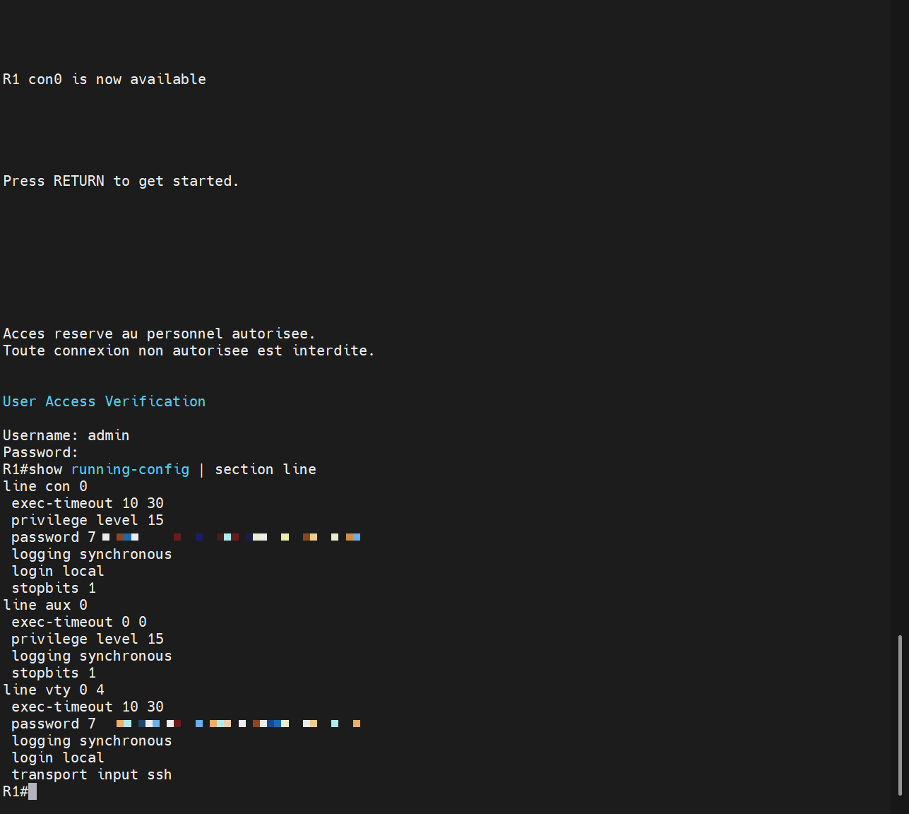

À la connexion, R1 affiche la bannière puis demande `Username:` et `Password:` : `login local` fonctionne. `line con 0` et `line vty 0 4` ont `exec-timeout 10 30`, `logging synchronous` et `login local` ; la ligne VTY a `transport input ssh`. Les mots de passe apparaissent en `password 7 …` : `service password-encryption` les a masqués (je les ai en plus **pixelisés** sur la capture).

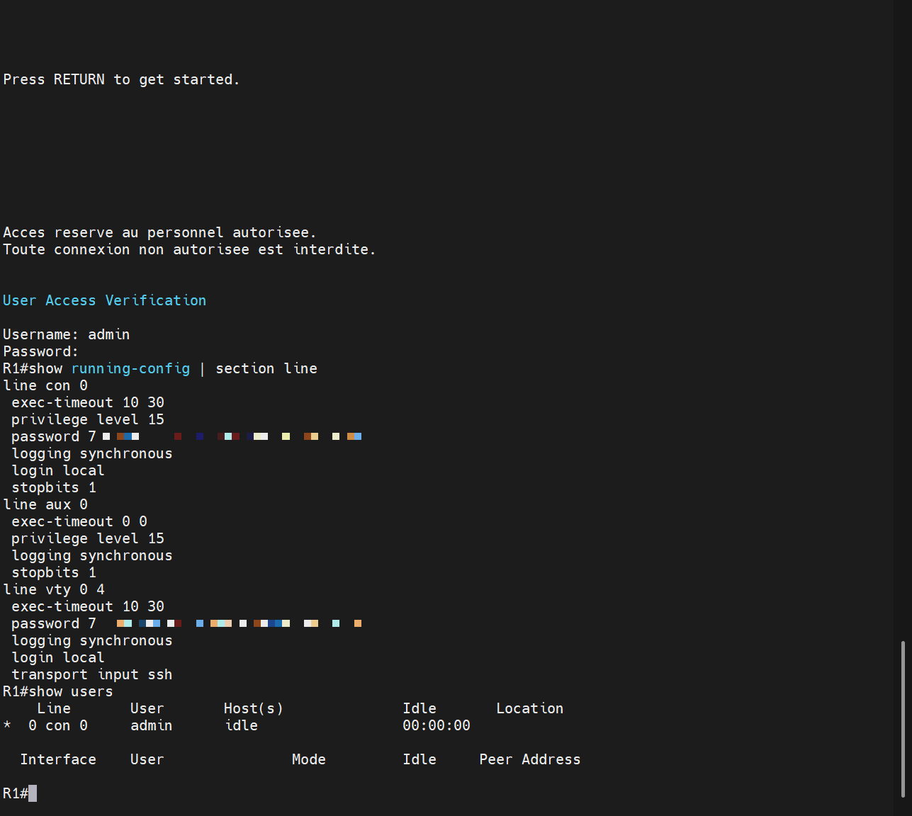

`show users` montre la session en cours : ligne `con 0`, utilisateur **`admin`**. On sait donc **qui** est connecté, et par où.

**Question 7.1 : pourquoi `service password-encryption` ne chiffre-t-il pas `enable secret` ? Rôle réel ?**
`enable secret` est **déjà** stocké sous forme de hachage (empreinte à sens unique, type 5 ou plus) dès qu'on le tape : il n'y a rien à faire de plus. `service password-encryption` ne concerne que les mots de passe qui seraient sinon en **clair** (`password` des lignes) et les transforme en **type 7**, un codage réversible très faible. Son seul vrai rôle : empêcher qu'un mot de passe soit lu « par-dessus l'épaule » sur un écran ou dans une config imprimée. Ce n'est pas une vraie protection, d'où la pixelisation des valeurs type 7 sur les captures.

**Question 7.2 : faiblesse d'un simple `password` sur les VTY par rapport à `login local` ?**
Avec un simple `password`, tout le monde partage le **même** mot de passe et personne ne s'identifie : impossible de savoir qui s'est connecté ou qui a fait une modification, impossible de retirer l'accès d'une seule personne sans changer le mot de passe pour tous. Avec `login local` et un compte nominatif, chaque connexion est rattachée à un utilisateur (visible dans `show users`), et SSH exige de toute façon un nom d'utilisateur.

### Étape 8 : SSH v2, désactivation de Telnet et des interfaces web (4 pts)

Sur les 6 équipements : `crypto key generate rsa modulus 2048` (clé de 2048 bits, quelques secondes de calcul), `ip ssh version 2`, `ip ssh time-out 60`, `ip ssh authentication-retries 3`, `no ip http server`, `no ip http secure-server`.

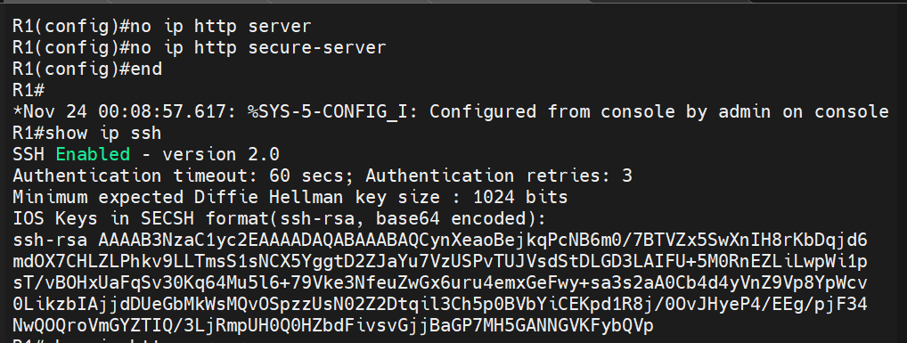

`show ip ssh` affiche **`SSH Enabled - version 2.0`**, un délai d'authentification de 60 s et **3 essais** autorisés, ce qui correspond exactement à la configuration. La longue chaîne `ssh-rsa AAAA…` est la **clé publique** du routeur : elle est faite pour être diffusée, ce n'est pas un secret.

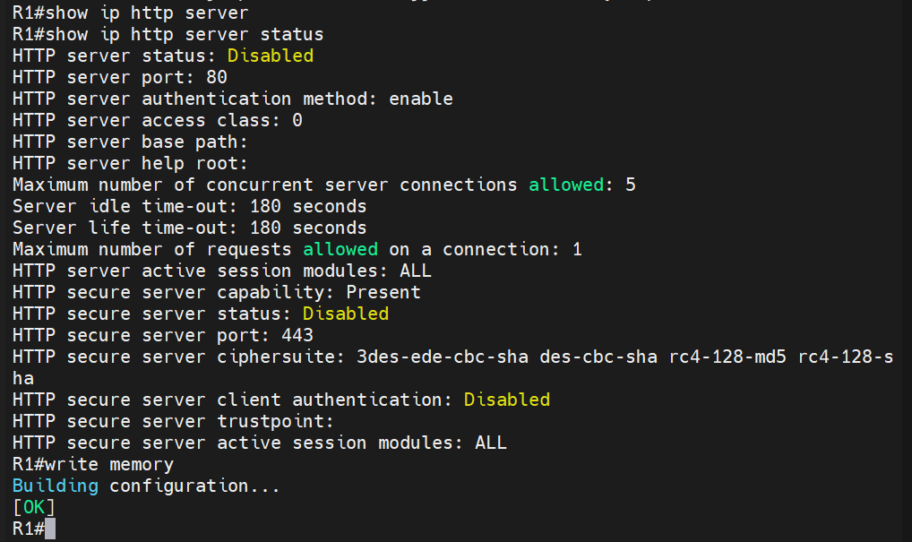

`HTTP server status: Disabled` et `HTTP secure server status: Disabled` : les deux interfaces web (HTTP port 80 et HTTPS port 443) sont coupées. La configuration est ensuite sauvegardée (`write memory` → `[OK]`).

**Question 8.1 : pourquoi désactiver `ip http server` ? Quel risque cela supprime-t-il ?**
Le serveur web d'administration est un service **inutile** ici (tout se fait en ligne de commande) et en HTTP les identifiants circulent **en clair** sur le réseau. Chaque service ouvert est aussi une porte d'entrée possible (failles du serveur web, essais de mots de passe). Le couper réduit la **surface d'attaque** : c'est le principe « on n'ouvre que ce qui sert ».

**Question 8.2 : que se passe-t-il si `transport input ssh` est absent ?**
Les lignes VTY gardent alors leur réglage par défaut, qui accepte en général **Telnet** (sur ces versions d'IOS, `transport input all` par défaut). Telnet resterait donc possible, et Telnet envoie tout en clair, mot de passe compris. Avec `transport input ssh`, seul SSH (chiffré) est accepté : le test 3 de l'étape 10 le prouve.

### Étape 9 : Trunk 802.1Q et ports des switches (3 pts)

Sur SW1 et SW2 :
- `interface range FastEthernet1/1 - 2` → `switchport mode access`, `switchport access vlan 1` (ports des routeurs) ;
- `interface FastEthernet1/15` → `switchport mode trunk`, `switchport trunk native vlan 1` (lien entre les switches) ;
- `interface range FastEthernet1/3 - 14` → `shutdown`, et `interface FastEthernet1/0` → `shutdown` (ports inutilisés).

> 💡 **`interface range`** applique les mêmes commandes à plusieurs ports d'un coup. Attention aux **espaces autour du tiret** : `FastEthernet1/3 - 14`.
> 💡 **Pourquoi éteindre les ports libres ?** Un port allumé et non surveillé permet à n'importe qui de brancher un PC dans le réseau. C'est une règle de base en entreprise.

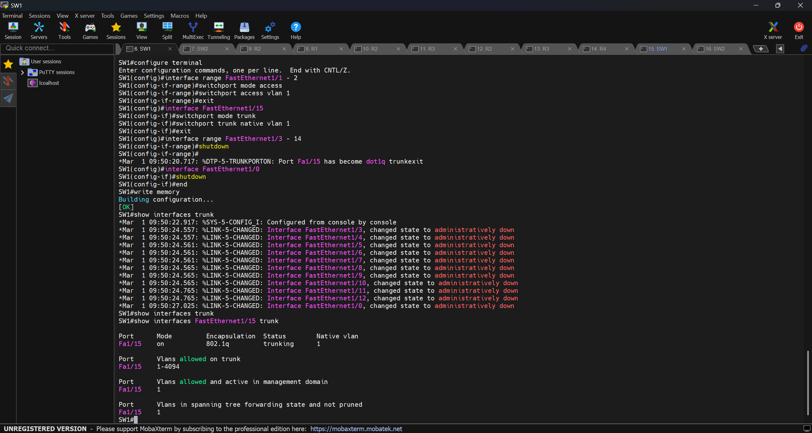

En haut, les commandes de l'étape 9 et le message `Port Fa1/15 has become dot1q trunk`. Les messages `changed state to administratively down` confirment l'extinction des ports libres (`Fa1/0`, `Fa1/3` à `Fa1/12` visibles dans cet extrait). `show interfaces trunk` seul ne renvoie rien sur cet IOS : `show interfaces FastEthernet1/15 trunk` affiche le port **`Fa1/15`**, mode `on`, encapsulation **`802.1q`**, statut **`trunking`**, VLAN natif **`1`**.

**Question 9.1 : différence entre un port access et un port trunk ?**
Un port **access** appartient à **un seul VLAN** et envoie des trames normales, sans étiquette : on y branche un équipement final (PC, routeur, imprimante). Un port **trunk** transporte **plusieurs VLAN** sur un seul câble en ajoutant à chaque trame une **étiquette 802.1Q** qui indique son VLAN : on l'utilise entre deux switches (ou vers un routeur qui gère plusieurs VLAN).

**Question 9.2 : pourquoi le VLAN natif doit-il être identique aux deux extrémités ?**
Sur un trunk, les trames du VLAN natif passent **sans étiquette**. Chaque switch range une trame sans étiquette dans **son** VLAN natif. Si les deux côtés n'ont pas le même, une trame partie du VLAN 1 d'un côté arrive dans un autre VLAN de l'autre côté : le trafic se mélange entre VLAN (problème de sécurité et de fonctionnement), et les switches signalent une erreur `native VLAN mismatch`.

### Étape 10 : Tests d'accès et démonstration (4 pts)

Les quatre tests sont lancés **depuis R2**, comme le demande l'énoncé.

> 💡 **Sessions emboîtées.** Quand on se connecte en SSH de R2 vers R1, le prompt devient `R1#` : on travaille désormais **sur R1**. Pour revenir sur R2 il faut taper `exit`. Si on oublie, la connexion suivante part de R1, et non de R2 (c'est ce qui m'est arrivé, voir § 5). **Toujours regarder le prompt avant de lancer un test.**

**Test 1 : SSH vers R1, bannière affichée.**

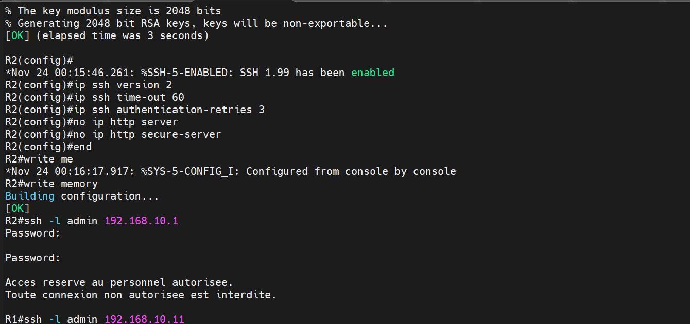

Depuis `R2#`, `ssh -l admin 192.168.10.1` demande le mot de passe, affiche la **bannière** « Acces reserve au personnel autorise… » puis le prompt **`R1#`** : la connexion SSH v2 avec le compte `admin` fonctionne.

**Test 2 : SSH vers SW1.**

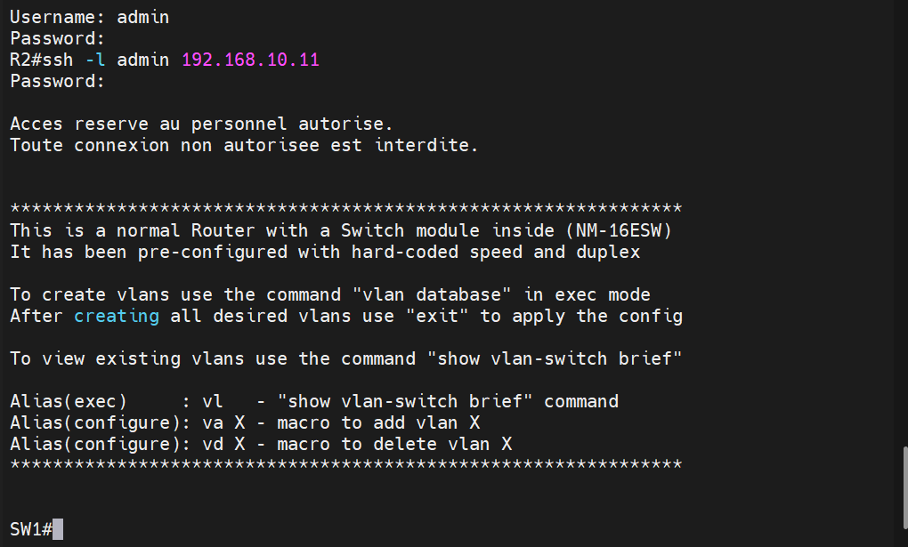

Depuis `R2#`, `ssh -l admin 192.168.10.11` affiche la bannière de SW1, puis la bannière d'origine de l'EtherSwitch, et enfin le prompt **`SW1#`** : SW1 est administrable à distance par son adresse de gestion `Vlan1`.

**Test 3 : Telnet vers R1 refusé.**

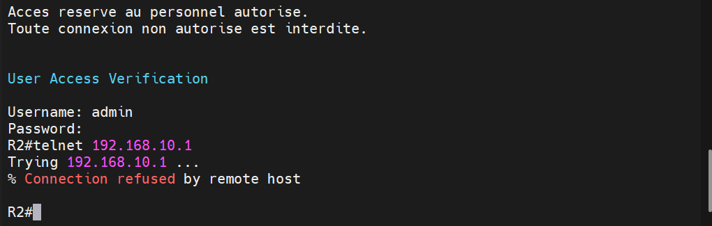

`telnet 192.168.10.1` répond **`% Connection refused by remote host`** et on reste sur `R2#` : R1 refuse Telnet grâce à `transport input ssh` sur ses lignes VTY.

**Test 4 : trois mauvais mots de passe SSH sur R1.**

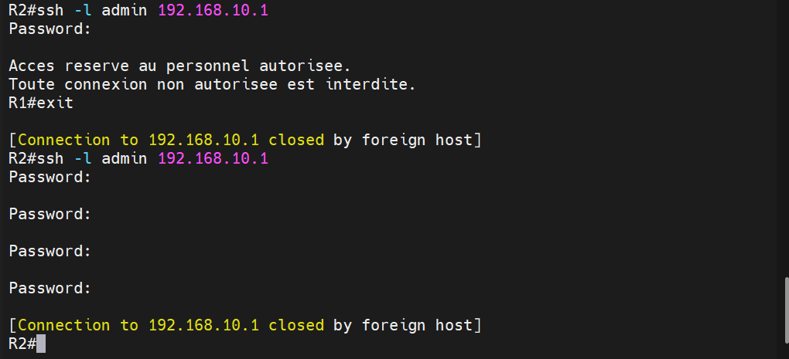

On voit d'abord une connexion réussie puis `exit` (retour sur `R2#`). Ensuite, nouveau `ssh -l admin 192.168.10.1` avec de **faux** mots de passe : les `Password:` se répètent sans ouvrir de session, puis R1 coupe la connexion (**`[Connection to 192.168.10.1 closed by foreign host]`**) et on revient sur `R2#`. C'est l'effet de `ip ssh authentication-retries 3` : après 3 échecs, aucune tentative supplémentaire n'est possible dans cette connexion. Pour réessayer, il faut tout recommencer, ce qui ralentit une attaque par essais successifs.

### Étape 11 : Sauvegarde et annulation (2 pts)

`write memory` a été lancé sur les 6 équipements (réponse `[OK]`, visible par exemple sur les captures 16 et 17). Ensuite, démonstration d'annulation sur R2 : on supprime l'adresse IP avec `no`, puis on la remet.

État **avant** l'annulation :

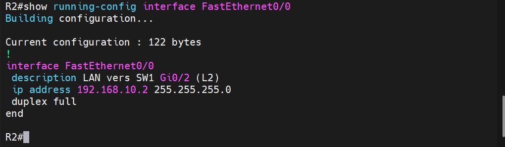

L'interface `FastEthernet0/0` de R2 a l'adresse `192.168.10.2 255.255.255.0`.

Les commandes d'annulation puis de rétablissement :

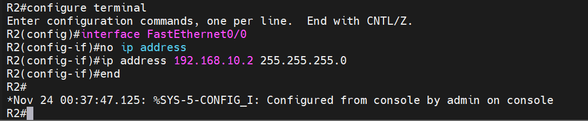

Dans `interface FastEthernet0/0` : `no ip address` (l'adresse est retirée), puis `ip address 192.168.10.2 255.255.255.0` (elle est remise), puis `end`. Le message `%SYS-5-CONFIG_I: Configured from console by admin` montre que la modification a été faite par l'utilisateur `admin`.

État **après**, puis sauvegarde :

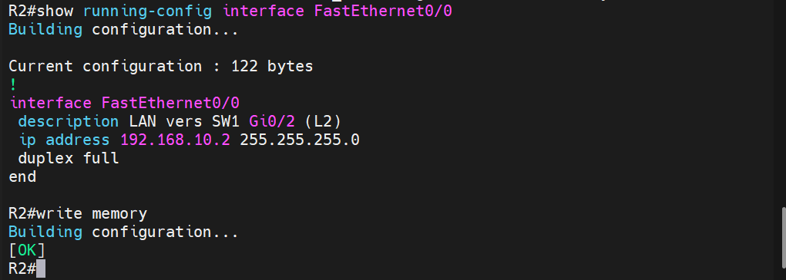

`show running-config interface FastEthernet0/0` montre de nouveau l'adresse `192.168.10.2` : l'interface est revenue à son état d'origine. `write memory` répond `[OK]` : cet état est enregistré.

> 💡 **Règle générale Cisco.** Pour annuler presque n'importe quelle commande, on retape la même commande précédée de **`no`** (`no shutdown`, `no ip address`, `no banner motd`, `no hostname`…).

**Question 11.1 : pourquoi `write memory` est-il indispensable après une annulation ?**
Toutes les commandes modifient la **running-config**, qui est en mémoire vive (RAM) et disparaît au redémarrage. Au démarrage, l'équipement recharge la **startup-config**, stockée en NVRAM. Sans `write memory` (qui copie la running-config dans la startup-config), un redémarrage ferait revenir l'ancienne configuration : l'annulation serait perdue, ou à l'inverse une erreur annulée réapparaîtrait. On sauvegarde donc **après chaque état validé**.

---

## 5. Problèmes rencontrés

| # | Problème | Cause | Solution / ce que j'en retiens |
|---|---|---|---|
| 1 | Erreurs rouges au démarrage du premier projet (`vm start R1`, `AUTOIDLEPC`, `UDP NIO`) | Nœuds supprimés et recréés, cartes changées pendant que d'autres tournaient ; carte `C7200-IO-GE-E` signalée instable dans Dynamips | Nouveau projet propre `TP_v2_GiocantiPaul` ; slot 0 en `C7200-IO-FE` sur R1 à R4 |
| 2 | Ancien projet rangé dans un dossier nommé `7, changed state to down` | Un message de console collé par erreur dans le champ du nom du projet | Nouveau projet dans `D:\PPE\Network\TP_v2_GiocantiPaul` |
| 3 | `unable to create UDP NIO` (port 10011) en créant un câble | Dynamips n'arrive pas à utiliser ce port UDP local (probablement réservé par Windows/Hyper-V) | GNS3 réessaie seul sur un autre port : le câble est créé. Erreur sans conséquence, vérifiée dans la topologie |
| 4 | MobaXterm ne s'ouvre pas depuis GNS3 : `[WinError 2] Le fichier spécifié est introuvable` | Le modèle « MobaXterm » de GNS3 vise l'ancien dossier `MobaXterm Personal Edition` | Chemin corrigé dans *Edit → Preferences → General → Console applications* (`…\Mobatek\MobaXterm\MobaXterm.exe`), en mode « Custom » : resélectionner le modèle écrase la correction |
| 5 | Onglet MobaXterm « Session stopped », terminal local qui se ferme | Module **CygUtils** absent : la commande GNS3 passe par le terminal local de MobaXterm | Plugin CygUtils téléchargé sur le site MobaXterm et copié dans le dossier de MobaXterm |
| 6 | Bannière qui ne se termine pas (`banner motd#` sans espace) | IOS prend alors la **première lettre du texte** (`m`) comme délimiteur | Taper `m` pour sortir, puis refaire avec `banner motd #` |
| 7 | Bannière tapée en mode `R1#` : commande refusée | `banner` est une commande de configuration | Passer en `configure terminal` avant ; **toujours lire le prompt** |
| 8 | Mot de passe accepté **avec** les chevrons `<…>` | Chevrons recopiés depuis le modèle de l'énoncé (ils signifient « à remplacer ») | Mots de passe retapés sans chevrons |
| 9 | Un `?` dans un mot de passe affiche l'aide au lieu d'être pris comme caractère | `?` déclenche l'aide contextuelle d'IOS partout, même dans un argument | Pas de `?` dans un mot de passe Cisco |
| 10 | Fautes de frappe dans les filtres (`banner4`…) : rien ne s'affiche | Le filtre `include` cherche le texte exact | Capture refaite avec la bonne commande |
| 11 | `show banner motd` refusée | Cette commande n'existe pas sur cette version d'IOS | `show running-config \| begin banner` ou le filtre de l'étape 2 |
| 12 | `show interfaces trunk` ne renvoie rien sur SW1 | Particularité de l'IOS EtherSwitch c3725 | `show interfaces FastEthernet1/15 trunk` |
| 13 | Étape 10 : tests 2 à 4 lancés par erreur depuis R1 puis SW1 | Oubli de `exit` après le premier SSH : les connexions se sont emboîtées (R2 → R1 → SW1) | `exit` jusqu'à revoir `R2#`, puis tests refaits depuis R2 (captures 19 à 21) |
| 14 | Étape 10, test 4 : premier essai fait avec le **bon** mot de passe | Mauvaise lecture de la consigne | Refait avec 3 faux mots de passe (capture 21) |

---

## 6. Tableau de validation

| Étape | Thème | Points | Preuve | État |
|---|---|---|---|---|
| 1 | Démarrage et interfaces | 2 | 00, 01 | ✅ |
| 2 | Nom, domaine, bannière | 3 | 02 à 07 + Q2.1, Q2.2 | ✅ |
| 3 | Adressage IP des routeurs | 3 | 08 + Q3.1 | ✅ |
| 4 | Adressage IP des switches | 2 | 09, 10 + Q4.1 | ✅ |
| 5 | Passerelle par défaut | 2 | 11 + Q5.1 | ✅ |
| 6 | Connectivité | 2 | 12 | ✅ |
| 7 | Mots de passe et lignes | 3 | 13, 14 + Q7.1, Q7.2 | ✅ |
| 8 | SSH v2, Telnet et HTTP | 4 | 15, 16 + Q8.1, Q8.2 | ✅ |
| 9 | Trunk et ports | 3 | 17 + Q9.1, Q9.2 | ✅ |
| 10 | Tests d'accès | 4 | 18 à 21 | ✅ |
| 11 | Sauvegarde et annulation | 2 | 22 à 24 + Q11.1 | ✅ |
| | **Total brut** | **30** | | |

---

## 7. Livrables

| N° | Livrable | Emplacement |
|---|---|---|
| 1 | Projet GNS3 `TP_v2_GiocantiPaul.gns3` | [Fichier du projet dans le dépôt](https://github.com/L4ami/tp-reseau-cisco-gns3/blob/main/tp1-config-base-cisco/TP_v2_GiocantiPaul.gns3) (topologie en fin de TP1, sans les images IOS Cisco) |
| 2 | Captures des `show` | [Dossier `captures/` du dépôt](https://github.com/L4ami/tp-reseau-cisco-gns3/tree/main/tp1-config-base-cisco/captures) |
| 3 | Configurations `.cfg` de R1 à R4, SW1, SW2 | [Dossier `configs/` du dépôt](https://github.com/L4ami/tp-reseau-cisco-gns3/tree/main/tp1-config-base-cisco/configs) (valeurs des mots de passe masquées) |
| 4 | Réponses aux questions 2.1 à 11.1 | Dans ce rapport, à la fin de chaque étape |

> 🔒 Les mots de passe ne figurent ni dans ce rapport ni dans les captures (valeurs pixelisées) ni dans les fichiers `.cfg` publiés.
