# TP Switching : Spanning Tree Protocol (STP / RSTP)

###### tags: `GIT` `Satom` `GNS3` `Cisco` `TP` `STP` `802.1D` `RSTP` `PortFast` `BPDU Guard` `MobaXterm`

> **Geneva Institute of Technology · CFC informaticien · Cours réseau**
> Étudiant : **Paul Giocanti** · Énoncé : [TP Switching – Spanning Tree STP/RSTP](https://hackmd.io/@Formateur/S1Om20fkXl)
> Projet GNS3 : `TP_v2_GiocantiPaul.gns3` (le même projet que le TP1, qui évolue) · Console : MobaXterm (imposée)

---

## Sommaire

1. [Contexte et objectif](#1-Contexte-et-objectif)
2. [Environnement et écarts avec l'énoncé](#2-Environnement-et-écarts-avec-lénoncé)
3. [Topologie et plan d'adressage réalisés](#3-Topologie-et-plan-dadressage-réalisés)
4. [Phases 0 à 8 : réalisation, preuves et réponses](#4-Phases-0-à-8--réalisation-preuves-et-réponses)
5. [Récapitulatif des temps de coupure mesurés](#5-Récapitulatif-des-temps-de-coupure-mesurés)
6. [Questions de réflexion](#6-Questions-de-réflexion)
7. [Problèmes rencontrés](#7-Problèmes-rencontrés)
8. [Tableau de validation](#8-Tableau-de-validation)

---

## 1. Contexte et objectif

Au TP1, on avait deux switches reliés par un seul câble. Ici, on ajoute un **troisième switch** et on relie les trois en **triangle**. En entreprise, c'est ce qu'on fait pour avoir un **câble de secours** : si un lien lâche, le trafic passe par l'autre côté du triangle.

Le problème, c'est qu'un triangle est une **boucle**. Une trame de diffusion (broadcast, par exemple une requête ARP) serait recopiée par chaque switch sur tous ses ports et tournerait à l'infini, car une trame Ethernet n'a **pas de durée de vie** (pas de TTL comme un paquet IP). En quelques secondes, les liens et les processeurs des switches seraient saturés : c'est la **tempête de broadcast**.

Le **Spanning Tree Protocol (STP, norme 802.1D)** résout ce problème : les switches s'échangent des messages appelés **BPDU** (*Bridge Protocol Data Units*), élisent un **pont racine** (le « chef », *root bridge*) et mettent **un port en pause** (*blocking*) pour casser la boucle. Si un lien tombe, le port en pause est réactivé.

Le TP consiste à observer, puis à manipuler ce mécanisme :

- trouver le pont racine et le port bloqué par défaut (phases 1 à 3) ;
- choisir nous-mêmes le pont racine et influencer les chemins (phases 2 et 4) ;
- sécuriser les ports des routeurs avec **PortFast** et **BPDU Guard** (phase 5) ;
- provoquer des pannes et **mesurer le temps de coupure** (phases 6 et 7) ;
- comparer avec **RSTP** (802.1w), la version rapide (phase 8).

> 💡 **Méthode de travail retenue pour tout le TP.** Comme le demande l'énoncé, **je prédis le résultat avant de taper la commande**, puis je compare avec ce que le switch affiche. Chaque écart entre la prédiction et la sortie réelle est expliqué.

---

## 2. Environnement et écarts avec l'énoncé

| Élément | Énoncé | Réalisé | Pourquoi |
|---|---|---|---|
| Projet | topologie à construire | **Même projet GNS3 que le TP1**, recâblé | Consigne du formateur : un seul projet qui évolue de TP en TP |
| Noms des switches | ESW1, ESW2, ESW3 | **SW1, SW2** (gardés du TP1) **+ SW3** | Renommer ne change rien au fonctionnement ; garder les noms du TP1 reste cohérent avec le projet unique. **ESW1 = SW1, ESW2 = SW2, ESW3 = SW3** dans tout ce rapport. |
| Adressage | `192.168.1.0/24` | **`192.168.10.0/24`** gardé du TP1, SW3 = `.13` | Le formateur a précisé que les adresses n'ont pas d'importance : seul le résultat compte. On évite de reconfigurer les 6 équipements du TP1. |
| Interfaces des routeurs | `g0/0` | **`FastEthernet0/0`** | Routeurs c7200 du TP1 avec carte C7200-IO-FE |
| Switches | EtherSwitch (module NM-16ESW) | **EtherSwitch c3725 + NM-16ESW**, IOS 12.4(15)T14 | Conforme. Cet IOS est ancien : plusieurs commandes de l'énoncé, écrites pour des switches Catalyst récents, n'existent pas (voir lignes suivantes). |
| Ports de SW3 | « idem ESW1 » : f1/0-1 en accès | **f1/0 et f1/1 en trunk** | Sur SW3, f1/0 et f1/1 vont vers SW1 et SW2 (liens L4 et L5), notés **Trunk** dans le tableau de câblage de l'énoncé. « Idem » ne s'applique qu'aux noms et aux IP. |
| `show spanning-tree vlan 1 detail` | demandée (phase 2) | **refusée** : `% Invalid input` sous `detail` | Option absente de cet IOS ; `show spanning-tree vlan 1` affiche déjà tout le détail port par port (capture 11) |
| `show spanning-tree interface f1/x detail` | demandée (phase 3) | **non utilisée** | Même limite ; les rôles de SW3 sont prouvés par `show spanning-tree vlan 1` (captures 07 et 10) |
| `spanning-tree bpduguard enable` (par port) | demandée (phase 5) | **refusée** ; remplacée par **`spanning-tree portfast bpduguard`** (globale) | Sur cet IOS, BPDU Guard s'active pour tout le switch et protège tous les ports PortFast (captures 13 et 14). Effet identique, prouvé par le test (capture 18). |
| `show interfaces status err-disabled` | demandée (phase 5) | remplacée par `show interfaces FastEthernet1/1` et les messages système | Les messages `%PM-4-ERR_DISABLE` affichés par le switch suffisent à prouver la coupure |
| Test BPDU Guard | « petit commutateur » sur f1/1 | **SW3** branché sur SW1 f1/1 à la place de R2 | SW3 avait des ports libres : il joue le rôle du switch non autorisé |
| Phase 7 : ping | ping depuis R1 | **ping R3 → SW3** (`192.168.10.13`) | R1 est branché sur SW1, qu'on éteint : il est isolé et ne peut plus servir de source |
| `spanning-tree mode rapid-pvst` | phase 8 | **refusée** | Le module NM-16ESW ne gère que le STP 802.1D (captures 25 et 26). Comparaison RSTP faite avec les valeurs théoriques. |
| Priorité affichée | 32768 + n° de VLAN (Extended System ID) | **32768**, puis **4096** et **8192** exactement | Cet IOS n'ajoute pas le numéro de VLAN à la priorité affichée |

---

## 3. Topologie et plan d'adressage réalisés

### 3.1 Câblage

| Lien | Équipement A | Interface | Équipement B | Interface | Type | Rôle |
|---|---|---|---|---|---|---|
| L1 | R1 | Fa0/0 | SW1 | f1/0 | Accès | Hôte |
| L2 | R2 | Fa0/0 | SW1 | f1/1 | Accès | Hôte |
| L3 | SW1 | f1/2 | SW2 | f1/2 | Trunk | Inter-switch |
| L4 | SW1 | f1/3 | SW3 | f1/0 | Trunk | Inter-switch (boucle) |
| L5 | SW2 | f1/3 | SW3 | f1/1 | Trunk | Inter-switch (boucle) |
| L6 | R3 | Fa0/0 | SW2 | f1/0 | Accès | Hôte |
| L7 | R4 | Fa0/0 | SW2 | f1/1 | Accès | Hôte |

Les ports exacts de l'énoncé sont respectés : en STP, le **numéro de port** sert à départager deux chemins à égalité, donc un autre câblage changerait le port bloqué.

### 3.2 Plan d'adressage (VLAN 1)

| Équipement | Interface | Adresse IP | Masque |
|---|---|---|---|
| R1 | Fa0/0 | 192.168.10.1 | 255.255.255.0 |
| R2 | Fa0/0 | 192.168.10.2 | 255.255.255.0 |
| R3 | Fa0/0 | 192.168.10.3 | 255.255.255.0 |
| R4 | Fa0/0 | 192.168.10.4 | 255.255.255.0 |
| SW1 | Vlan1 | 192.168.10.11 | 255.255.255.0 |
| SW2 | Vlan1 | 192.168.10.12 | 255.255.255.0 |
| SW3 | Vlan1 | 192.168.10.13 | 255.255.255.0 |

---

## 4. Phases 0 à 8 : réalisation, preuves et réponses

### Phase 0 : Préparation (câblage, ports, connectivité)

Le projet du TP1 a été recâblé en triangle : les 5 anciens câbles ont été supprimés, SW3 a été ajouté et les 7 liens du tableau 3.1 ont été créés.

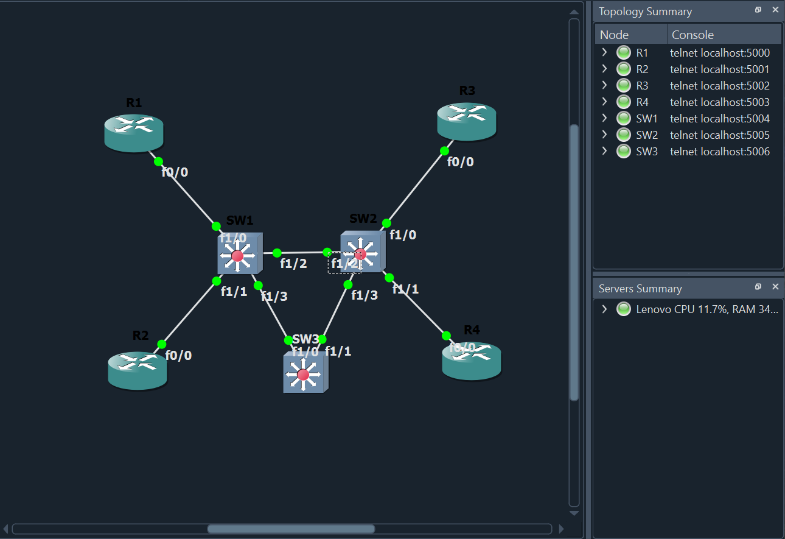

On voit le triangle SW1 – SW2 – SW3 (liens f1/2, f1/3 et f1/0 – f1/1), les routeurs R1/R2 sur SW1 et R3/R4 sur SW2. Les 7 équipements sont verts dans *Topology Summary* : ils sont démarrés.

Le TP1 avait laissé des réglages qui empêchent le TP2 de fonctionner : **f1/0 et f1/3 éteints** (ports inutilisés) et **f1/2 en mode accès**. Sur SW1, on remet donc les ports des routeurs en accès et les liens vers les autres switches en trunk, en rallumant tout.

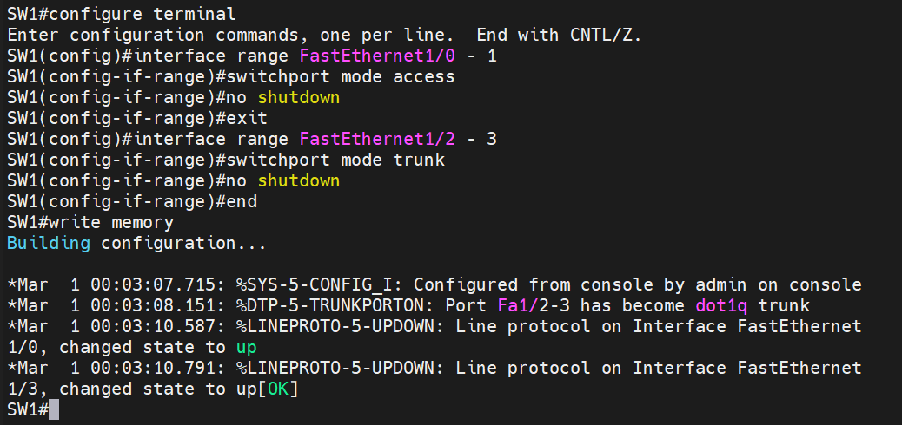

`Port Fa1/2-3 has become dot1q trunk` confirme les deux trunks, et `FastEthernet1/0` puis `1/3 … changed state to up` montrent que les ports éteints au TP1 sont rallumés. `write memory` répond `[OK]`.

Même configuration sur SW2. Une première fois, la configuration de SW3 a été tapée par erreur dans l'onglet de SW2 (voir problème 4). La capture montre la correction : la nouvelle adresse `.12` remplace la mauvaise et f1/0-1 repassent en accès.

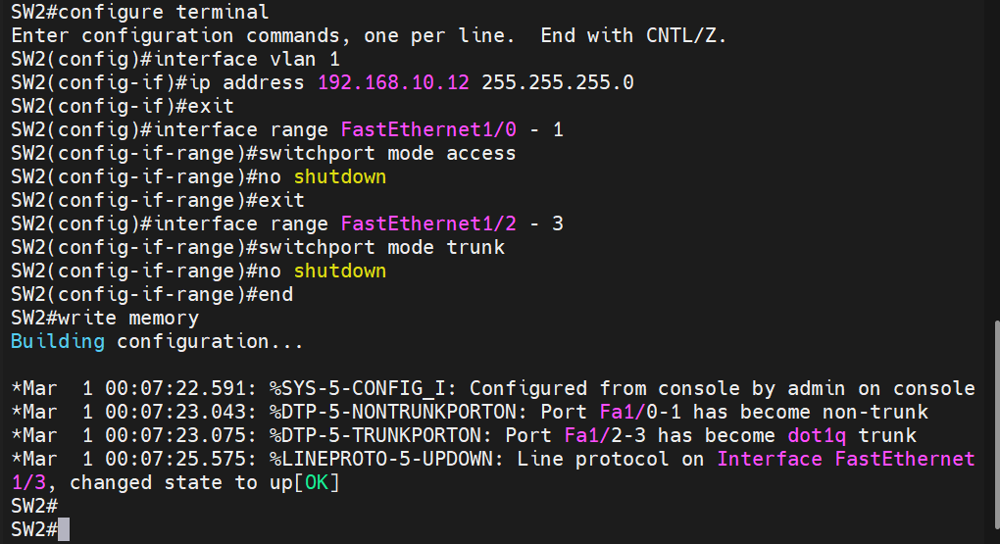

`Fa1/0-1 has become non-trunk` (ports vers R3 et R4 en accès) et `Fa1/2-3 has become dot1q trunk` (liens vers SW1 et SW3) : SW2 est conforme.

SW3 est un switch neuf : on lui donne son adresse de gestion et on met en trunk ses deux ports, qui vont vers SW1 et SW2.

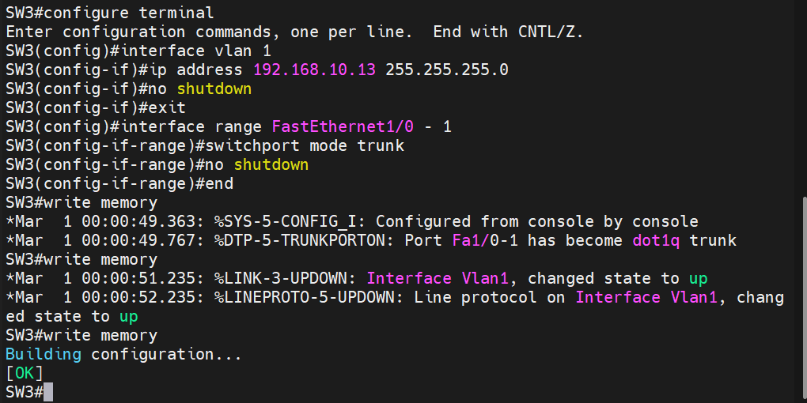

`Interface Vlan1, changed state to up` et `Fa1/0-1 has become dot1q trunk` : SW3 est joignable et relié au triangle.

L'énoncé exige que tout le monde se réponde avant de commencer le STP. Depuis R1, ping des 6 autres équipements :

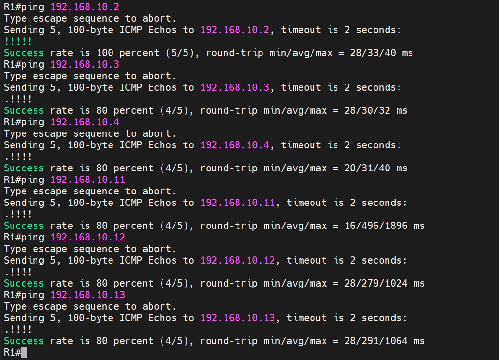

Les 6 pings réussissent (`!!!!!` ou `.!!!!`). Le premier `.` est normal : le temps que R1 obtienne l'adresse MAC de la cible par ARP, le premier paquet est perdu.

> 💡 **À retenir.** Un port de switch passe par **Listening (15 s) puis Learning (15 s)** avant de transmettre. Un ping lancé juste après un changement de câblage peut donc échouer pendant une trentaine de secondes : ce n'est pas une panne, c'est le STP qui vérifie qu'il ne crée pas de boucle.

### Phase 1 : Observer le STP par défaut

**Prédiction.** Les trois switches ont la priorité par défaut, 32768. Le **BID** (*Bridge ID*, identifiant de pont = priorité + adresse MAC) sera donc départagé par l'**adresse MAC** : le switch à la plus petite MAC sera root. Une seule boucle existe, donc **un seul port** sera bloqué.

Sur chaque switch : `show spanning-tree vlan 1`.

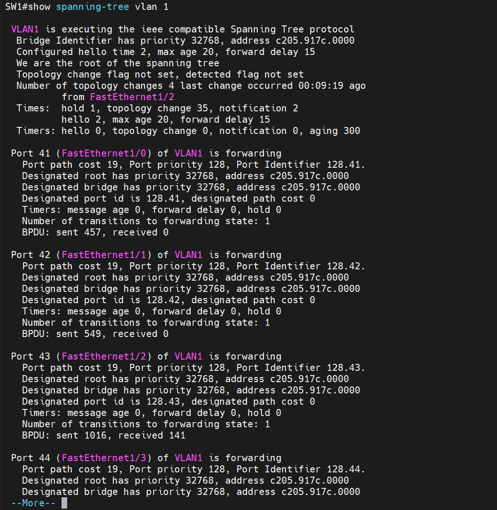

SW1 affiche `Bridge Identifier has priority 32768, address c205.917c.0000` et **`We are the root of the spanning tree`** : SW1 est le pont racine. Tous ses ports sont `forwarding`.

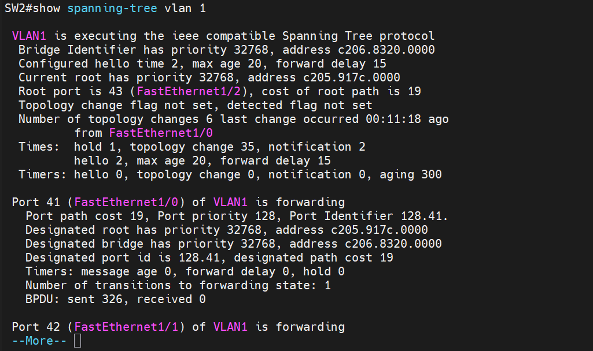

SW2 (`c206.8320.0000`) annonce `Current root has priority 32768, address c205.917c.0000` : il reconnaît SW1 comme root. `Root port is 43 (FastEthernet1/2), cost of root path is 19` : il le joint en direct par L3.

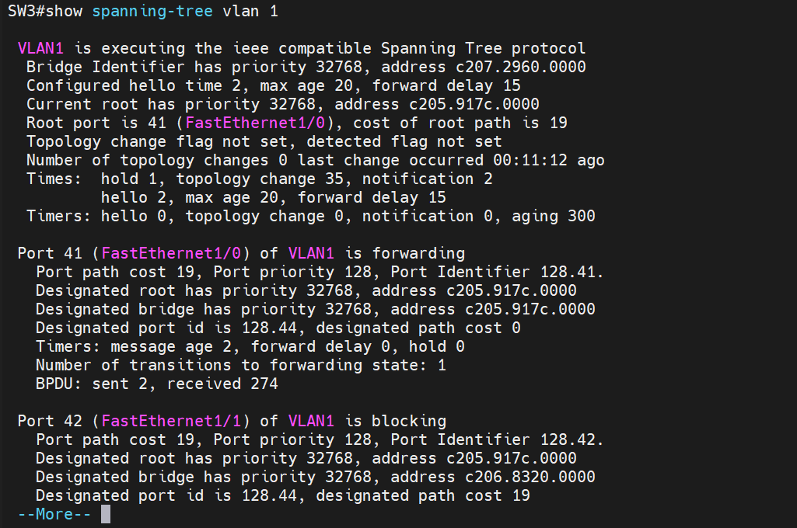

SW3 (`c207.2960.0000`) désigne lui aussi `c205.917c.0000` comme root, par `Root port is 41 (FastEthernet1/0), cost 19` (lien L4). Surtout : **`Port 42 (FastEthernet1/1) of VLAN1 is blocking`**. C'est le seul port bloqué du triangle.

**Réponses aux questions de la phase 1**

1. **Root ID annoncé** : priorité **32768**, adresse **c205.917c.0000** (SW1).
2. **Même Root ID sur les trois switches** : chaque switch relaie dans ses BPDU le meilleur root qu'il connaît. Tant qu'un switch reçoit un BPDU qui annonce un meilleur BID que le sien, il l'adopte. Au bout de quelques échanges, tous les switches sont d'accord sur le même root.
3. **Root = SW1** : les priorités sont égales, donc la MAC départage. `c205…` < `c206…` (SW2) < `c207…` (SW3).
4. **Un seul port Blocking : SW3 f1/1** (lien L5). C'est le seul lien du triangle qui ne touche pas le root.

> 💡 **Méthode : élection du STP en 3 étapes.** 1) Le plus petit BID devient **root**. 2) Chaque autre switch choisit son **Root Port** : le port au coût cumulé le plus bas vers le root (FastEthernet = coût **19**). 3) Sur chaque câble, un seul côté transmet, le **Designated Port** (le plus proche du root ; à égalité, le BID de l'émetteur le plus bas). Tout port ni Root ni Designated est **bloqué**.

### Phase 2 : Prédire puis forcer le pont racine

**Prédiction.** Avec la priorité 4096, SW1 sera root quelle que soit sa MAC. Avec 8192, SW2 deviendra le **root de secours** : si SW1 tombe, il a le plus petit BID restant.

On n'attend pas que le hasard des MAC choisisse le chef : en entreprise, on désigne soi-même le switch du cœur de réseau comme root, et son remplaçant.

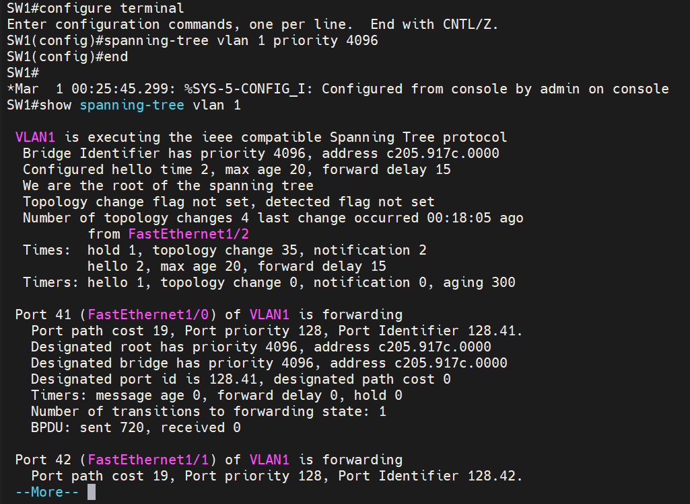

Après `spanning-tree vlan 1 priority 4096` : `Bridge Identifier has priority 4096` et toujours `We are the root of the spanning tree`.

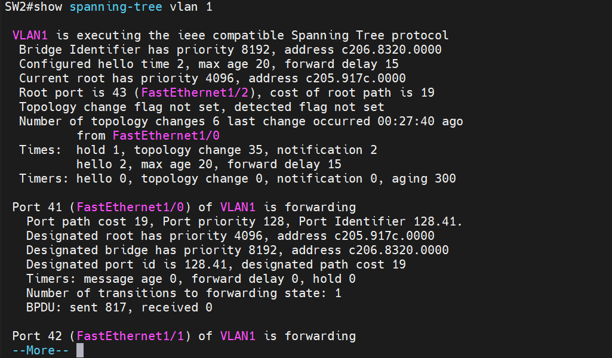

SW2 a bien `priority 8192` et annonce `Current root has priority 4096, address c205.917c.0000` : ESW1 (SW1) est le root vu de SW2.

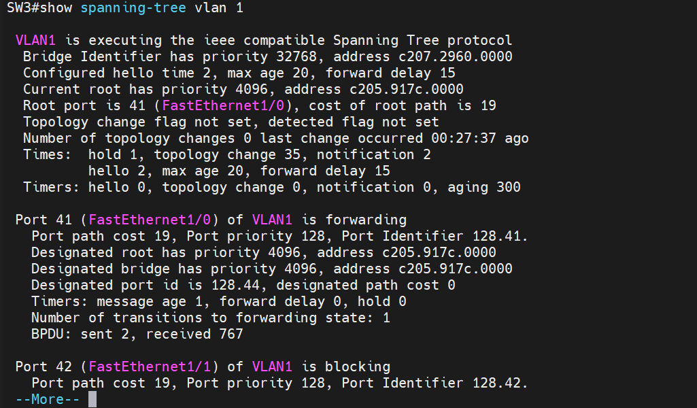

SW3 reste à 32768 et désigne aussi `priority 4096, address c205.917c.0000`. Son port f1/1 est toujours `blocking`.

L'énoncé demande `show spanning-tree vlan 1 detail` :

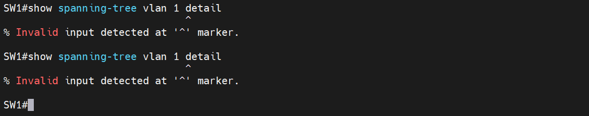

Le `^` pointe sous `detail` : le switch comprend `show spanning-tree vlan 1` mais ne connaît pas cette option. Sur cet IOS, la commande sans `detail` affiche déjà le détail de chaque port.

> 💡 **À retenir.** La priorité ne prend que des valeurs **multiples de 4096** (0, 4096, 8192… 61440), par défaut 32768. Plus elle est basse, plus le switch est prioritaire. Elle est enregistrée dans la **configuration** et non dans le boîtier : un switch de remplacement doit recevoir la même config. Réflexe en cas de `% Invalid input` : taper **`?`** à la place du mot refusé pour voir ce que l'IOS accepte.

### Phase 3 : Analyser les rôles des ports

Cet IOS n'écrit pas les mots *Root*, *Designated* ou *Alternate*. Ils se **déduisent** de la sortie de `show spanning-tree vlan 1` (captures 08 à 10) :

- la ligne `Root port is …` donne le **Root Port** ;
- un port dont le `Designated bridge` est le switch lui-même est **Designated** ;
- un port `blocking` est **Alternate**.

| Switch | Port | Lien | Rôle | État |
|---|---|---|---|---|
| SW1 (root) | f1/0, f1/1, f1/2, f1/3 | L1, L2, L3, L4 | Designated | Forwarding |
| SW2 | f1/2 | L3 | **Root** (coût 19) | Forwarding |
| SW2 | f1/0, f1/1, f1/3 | L6, L7, L5 | Designated | Forwarding |
| SW3 | f1/0 | L4 | **Root** (coût 19) | Forwarding |
| SW3 | f1/1 | L5 | **Alternate** | **Blocking** |

**Question clé : pourquoi SW3 f1/1 est-il bloqué ?**

1. SW3 peut rejoindre SW1 directement par L4 (coût **19**) ou via SW2 par L5 puis L3 (19 + 19 = **38**). Le chemin direct est moins cher : **f1/0 est son Root Port**.
2. Sur le segment L5, SW2 et SW3 sont tous les deux à **19** du root : il y a égalité. Le BID de l'émetteur départage : **SW2 (8192) < SW3 (32768)**. **SW2 f1/3 est Designated**, et SW3 f1/1, qui n'est ni Root ni Designated, est **bloqué**.

C'est exactement la lecture attendue par l'énoncé.

### Phase 4 : Influencer le choix avec le coût de port

**Prédiction.** Avec un coût de 200 sur SW3 f1/0, le chemin direct vaut 200 et le chemin via SW2 vaut 19 + 19 = 38. SW3 choisira donc **f1/1 comme Root Port**, et **f1/0 sera bloqué**.

Sur SW3 : `interface FastEthernet1/0`, `spanning-tree cost 200`, puis `show spanning-tree vlan 1` après environ 50 secondes.

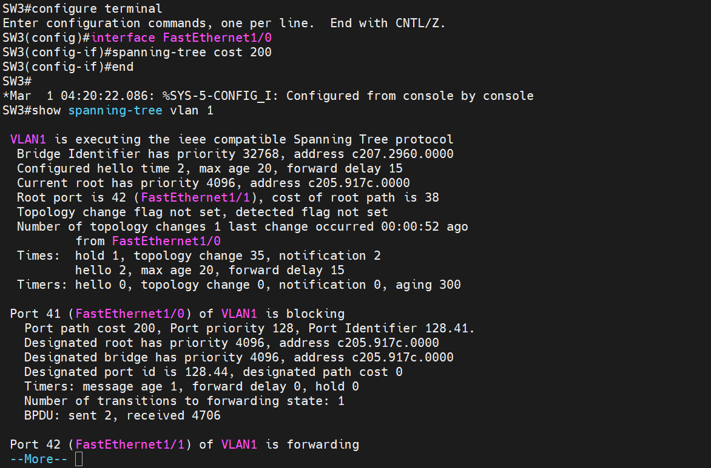

`Root port is 42 (FastEthernet1/1), cost of root path is 38` et `Port 41 (FastEthernet1/0) … is blocking` avec `Port path cost 200` : la prédiction est vérifiée. Le port bloqué a changé parce que le STP choisit toujours le **chemin le moins cher**. En gonflant le coût du lien direct, le détour par SW2 est devenu le meilleur chemin.

Le coût par défaut est ensuite remis avec `no spanning-tree cost` sur SW3 f1/0, comme le demande l'énoncé.

> 💡 **À retenir.** La **priorité** décide **qui est root** ; le **coût** décide **par où passe le trafic** vers le root. En entreprise, on règle le coût pour forcer le trafic sur le lien le plus rapide ou le plus fiable.

### Phase 5 : Sécuriser les ports d'accès (PortFast et BPDU Guard)

Les ports f1/0 et f1/1 de SW1 et SW2 ne mènent qu'à des routeurs, jamais à un switch. Deux protections s'y appliquent :

- **PortFast** : le port passe directement en *forwarding*, sans attendre les 30 s de Listening et de Learning. C'est ce qui permet à un poste d'avoir le réseau dès qu'on le branche.
- **BPDU Guard** : si un BPDU arrive sur un port PortFast, c'est qu'un **switch** y a été branché. Le port est alors coupé (*err-disabled*).

Sur SW1 : `interface range FastEthernet1/0 - 1`, `spanning-tree portfast`, `spanning-tree bpduguard enable`.

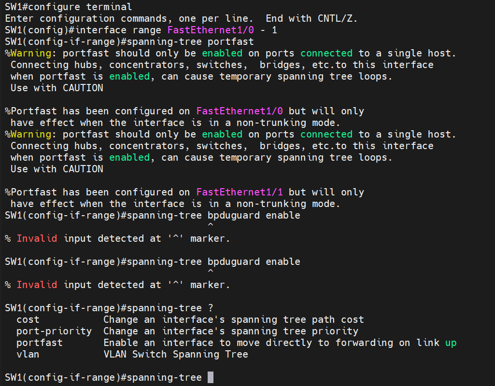

PortFast est accepté avec l'avertissement normal de Cisco (`portfast should only be enabled on ports connected to a single host`). En revanche, `spanning-tree bpduguard enable` est refusé, et `spanning-tree ?` au niveau du port ne propose que `cost`, `port-priority`, `portfast` et `vlan` : cet IOS n'a pas de BPDU Guard par port.

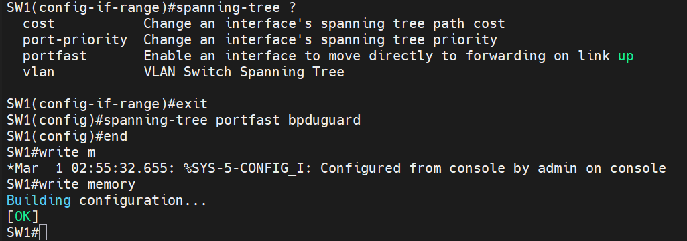

La forme globale **`spanning-tree portfast bpduguard`** est acceptée, puis enregistrée (`write memory` → `[OK]`). Elle active BPDU Guard sur **tous les ports PortFast** du switch. Même configuration appliquée sur SW2.

**Test de BPDU Guard.** Le câble de R2 est débranché de SW1 f1/1, et SW3 est branché à sa place (SW1 f1/1 ↔ SW3 f1/2) pour jouer le switch non autorisé.

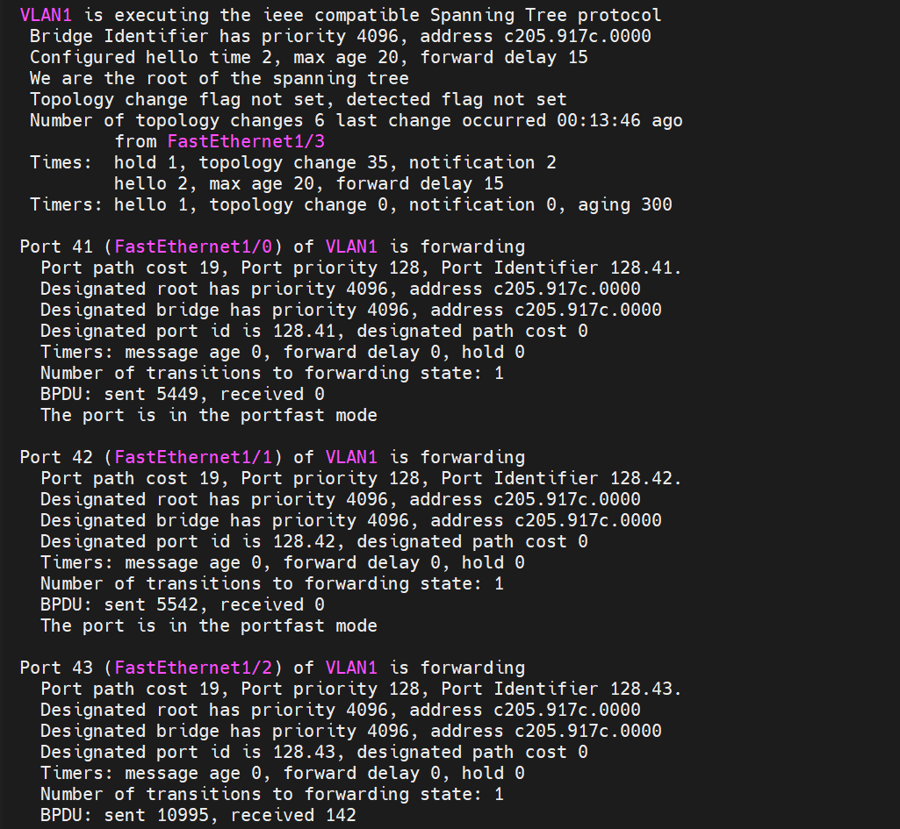

`The port is in the portfast mode` sur f1/0 et f1/1 confirme PortFast. Mais f1/1 indique **`BPDU: sent 5542, received 0`** et reste `forwarding` : BPDU Guard ne se déclenche pas. Première explication : en 802.1D, **seul le port Designated d'un segment envoie des BPDU**. SW1 est root, donc c'est lui qui émet sur ce câble ; SW3, moins prioritaire, écoute sans rien envoyer.

Pour simuler un vrai attaquant, SW3 reçoit la priorité **0** (`spanning-tree vlan 1 priority 0`) : il veut devenir root et envoie donc des BPDU sur tous ses ports.

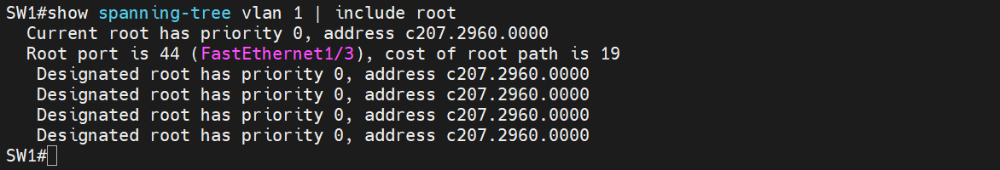

Sur SW1 : `Current root has priority 0, address c207.2960.0000` avec `Root port is 44 (FastEthernet1/3)`. **SW3 a pris le rôle de root** en passant par le lien L4, qui n'a pas BPDU Guard puisque c'est un lien inter-switch. C'est la démonstration de l'attaque : un switch mal intentionné peut détourner tout le trafic. BPDU Guard ne protège que les ports où il est activé.

Le câble de test, lui, ne transportait toujours rien :

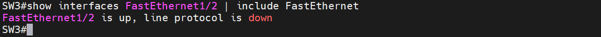

`FastEthernet1/2 is up, line protocol is down` : le câble créé dans GNS3 pendant que les switches tournaient n'avait pas été établi par Dynamips (voir problème 5). SW3 a été arrêté puis redémarré dans GNS3, ce qui recrée ses liens, puis la priorité 0 a été remise.

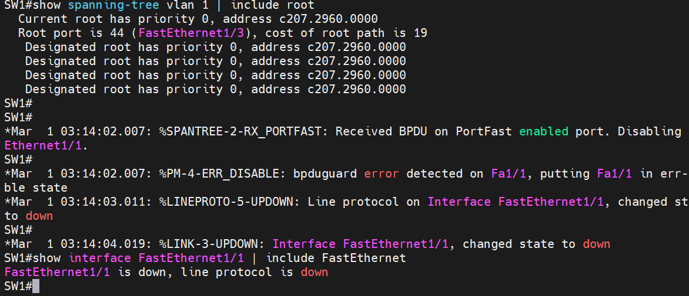

Cette fois, SW1 affiche **`%SPANTREE-2-RX_PORTFAST: Received BPDU on PortFast enabled port. Disabling`**, puis **`%PM-4-ERR_DISABLE: bpduguard error detected on Fa1/1, putting Fa1/1 in err-disable state`**, et enfin `FastEthernet1/1 is down, line protocol is down`. BPDU Guard fonctionne : le switch non autorisé est déconnecté.

**Remise en état** : priorité normale sur SW3 (`no spanning-tree vlan 1 priority`), câble de test supprimé, R2 rebranché sur SW1 f1/1, port réactivé avec `shutdown` puis `no shutdown` (la méthode pour sortir un port de l'état *err-disabled*), puis redémarrage des équipements dans GNS3 pour rétablir les liens. Vérification par ping de R1 vers R2 et SW3.

> 💡 **À retenir.** Couper le port est plus sûr que d'ignorer le BPDU : un switch pirate en priorité 0 deviendrait root et verrait passer tout le trafic, et un switch branché par erreur pourrait créer une boucle invisible pour le STP. La coupure laisse aussi une **trace dans les logs** pour l'administrateur, qui doit réactiver le port lui-même.

### Phase 6 : Panne d'un lien et temps de convergence

Un ping continu de R1 vers R3 (`ping 192.168.10.3 repeat 100000`) passe par L3 (SW1 → SW2). On coupe L3 avec `shutdown` sur l'interface FastEthernet1/2 du lien. Le trafic doit alors faire le détour R1 → SW1 → SW3 → SW2 → R3, ce qui oblige SW3 à réactiver son port bloqué.

> 💡 **Mesure.** Le ping attend 2 secondes de réponse avant d'afficher un `.` : **chaque point = 2 s de coupure**.

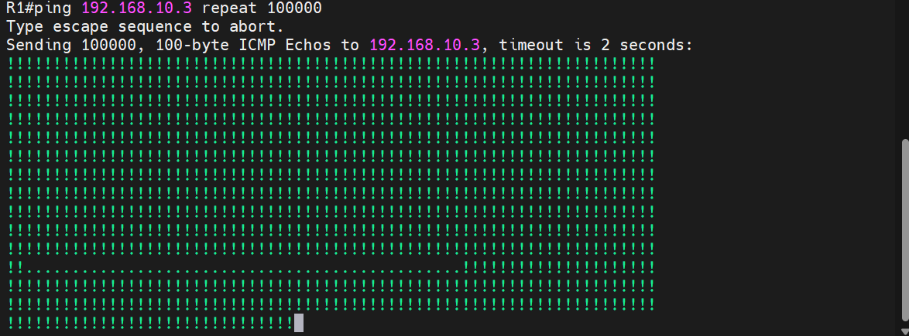

La ligne de points compte **47 `.`**, soit **environ 94 s** de coupure avant le retour des `!`.

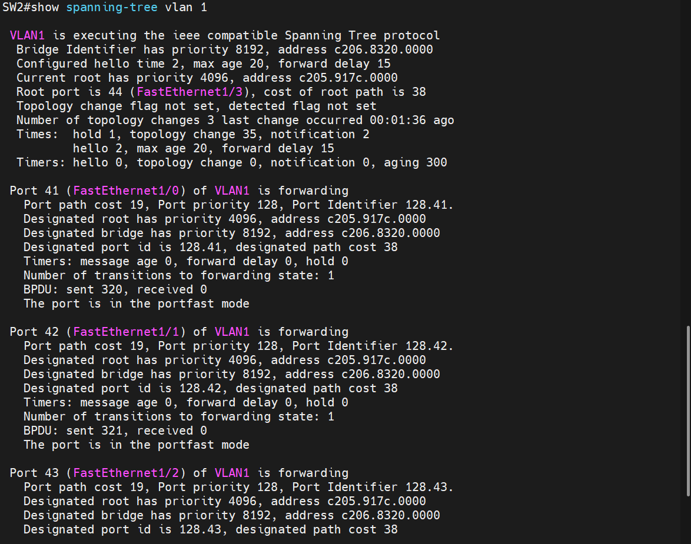

SW2 a toujours SW1 comme root (`priority 4096`), mais **`Root port is 44 (FastEthernet1/3), cost of root path is 38`** : son Root Port est passé de f1/2 à **f1/3**. Il rejoint le root par SW3.

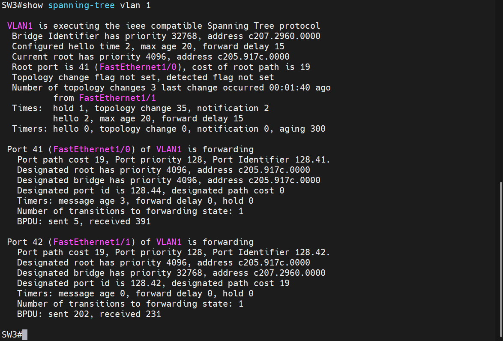

**`Port 42 (FastEthernet1/1) of VLAN1 is forwarding`** avec `Designated bridge has priority 32768, address c207.2960.0000` : le port de SW3 vers SW2 est passé d'**Alternate (blocking)** à **Designated (forwarding)**. Le câble de secours a pris le relais.

**Réponses aux questions de la phase 6**

1. Le port de SW2 qui change de rôle est **f1/3** (Designated → **Root**). Le port de SW3 qui passe d'Alternate à Designated est **f1/1**.
2. **Coupure mesurée : environ 94 s**, contre 30 à 50 s en théorie. Deux causes probables : SW2, privé de son chemin vers le root et deuxième meilleur BID (8192), a d'abord pu s'annoncer lui-même comme root, ce qui ajoute un recalcul ; et les switches sont **émulés par Dynamips** sur un PC, donc plus lents que du vrai matériel.
3. **Rétablissement** : `no shutdown` sur FastEthernet1/2.

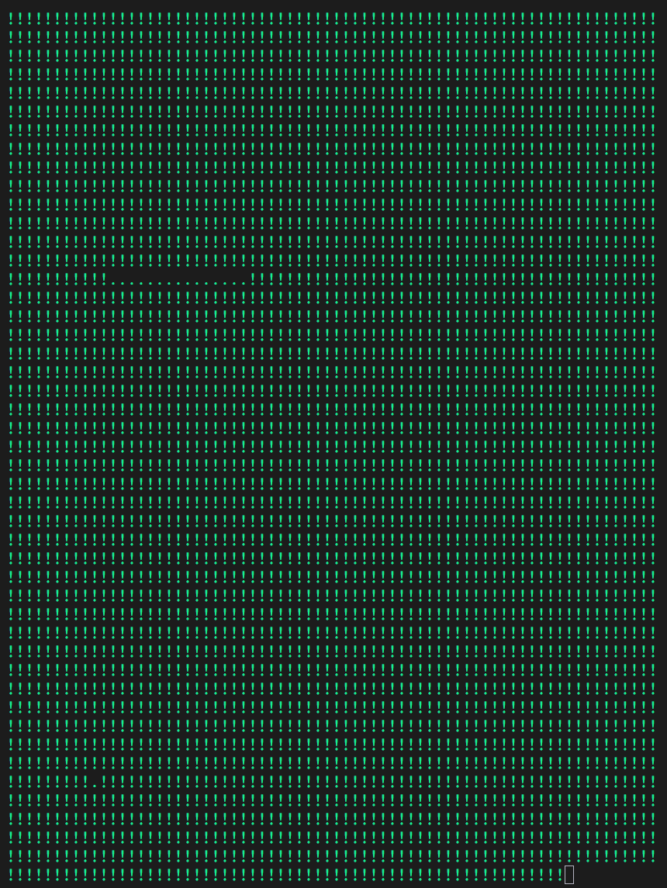

Une nouvelle coupure de **15 `.`, soit environ 30 s**, apparaît quand L3 revient. Le chemin direct (coût 19) redevient le meilleur : SW3 remet aussitôt f1/1 en *blocking*, alors que le lien L3 doit encore passer par **Listening (15 s) + Learning (15 s)** avant de transmettre. Pendant ces 30 s, aucun des deux chemins ne transmet. En 802.1D, **même la réparation d'un lien coupe le réseau**.

### Phase 7 : Panne du pont racine

**Prédiction.** Si SW1 tombe, **SW2 (8192)** devient root, puisqu'il a le plus petit BID restant (phase 2). SW3 ne peut plus joindre SW1 par f1/0 : son Root Port devient **f1/1**, vers SW2.

R1 étant branché sur SW1, le ping de mesure part de **R3 vers SW3** (`ping 192.168.10.13 repeat 100000`). On simule la panne avec `interface range FastEthernet1/0 - 3` puis `shutdown` sur SW1.

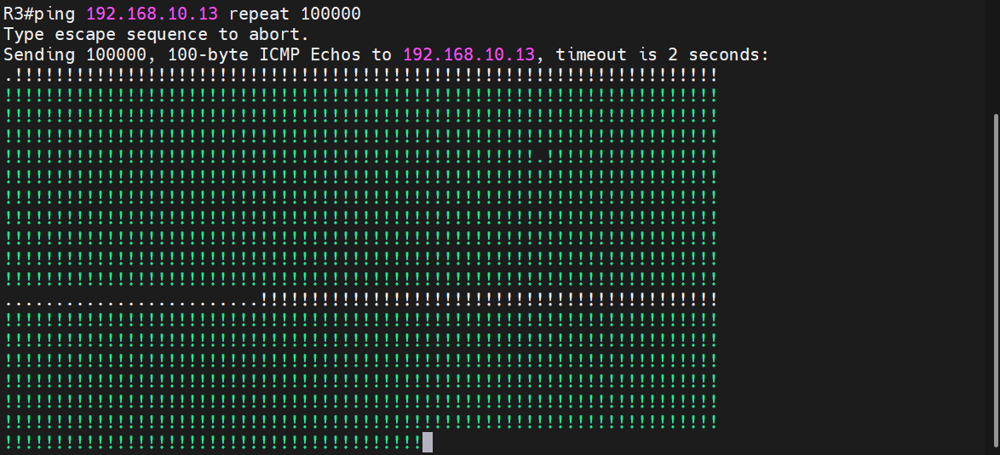

**25 `.`, soit environ 50 s** de coupure. C'est exactement la valeur théorique du 802.1D : **Max Age (20 s)**, le temps pendant lequel SW3 garde l'ancienne information du root avant de la juger périmée, puis **Listening (15 s)** et **Learning (15 s)** sur f1/1.

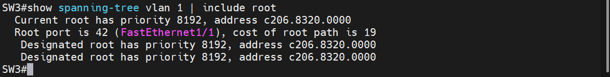

Sur SW3 : `Current root has priority 8192, address c206.8320.0000` (SW2) et **`Root port is 42 (FastEthernet1/1), cost of root path is 19`**. La prédiction est vérifiée.

**Pourquoi R1 et R2 sont-ils isolés ?** Ils ne sont reliés qu'à SW1, par **un seul câble chacun**. Le STP gère les chemins redondants **entre switches**, mais il n'existe aucun second chemin vers R1 et R2 : il n'a rien à réactiver. SW1 est ici un **point unique de défaillance** (*single point of failure*). En entreprise, les équipements critiques sont branchés sur deux switches.

### Phase 8 : Comparer STP et RSTP

Après avoir rallumé les ports de SW1, on tente de passer en RSTP en mode configuration globale :

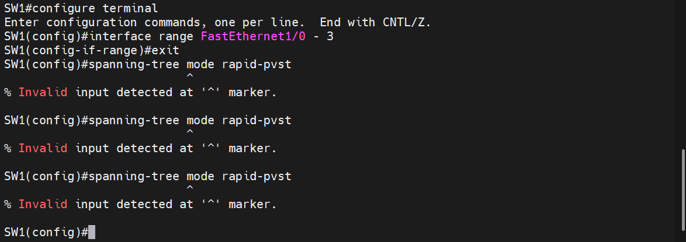

Au prompt `SW1(config)#`, `spanning-tree mode rapid-pvst` est refusé, avec le `^` **sous le mot `mode`** : l'IOS ne connaît même pas le choix du mode STP.

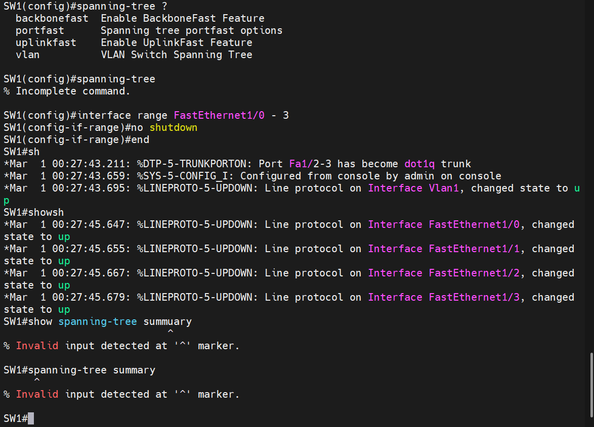

`spanning-tree ?` en mode global ne propose que `backbonefast`, `portfast`, `uplinkfast` et `vlan` : **pas de `mode`**. `show spanning-tree summary` est aussi refusée. Les ports de SW1 sont ensuite rallumés (`changed state to up` sur f1/0 à f1/3). **Le module NM-16ESW ne fait que du STP 802.1D** : le RSTP ne peut pas être mesuré ici. On note que `backbonefast` et `uplinkfast` sont les anciennes extensions propriétaires de Cisco qui accéléraient le 802.1D avant l'arrivée du RSTP.

**Comparaison théorique 802.1D / 802.1w**

| | STP 802.1D (mesuré) | RSTP 802.1w (théorie) |
|---|---|---|
| Panne d'un lien (L3) | ≈ 94 s mesurés (30 à 50 s en théorie) | 1 à 2 s environ |
| Panne du root | ≈ 50 s mesurés | quelques secondes |
| Retour d'un lien | ≈ 30 s mesurés | quasi immédiat |
| Mécanisme | attente des temporisateurs (Max Age 20 s, Forward Delay 2 × 15 s) | négociation **proposal / agreement** entre switches sur les liens **point-à-point** |
| Port de secours | bloqué, doit tout recommencer | rôle **Alternate** calculé à l'avance, il devient Root immédiatement |
| États des ports | Blocking, Listening, Learning, Forwarding (+ Disabled) | **Discarding**, Learning, Forwarding |

**Pourquoi RSTP est plus rapide.** Le RSTP n'attend pas les temporisateurs : entre deux switches reliés directement, l'un **propose** de passer en transmission et l'autre **accepte** après avoir bloqué ses propres ports non désignés, en quelques millisecondes. De plus, le port **Alternate** est déjà désigné comme remplaçant du Root Port : en cas de panne, il prend le relais sans attendre les 20 s de Max Age.

---

## 5. Récapitulatif des temps de coupure mesurés

| Événement | Ping | Points `.` | Coupure mesurée | Théorie 802.1D | Capture |
|---|---|---|---|---|---|
| Lien L3 coupé | R1 → R3 | 47 | ≈ 94 s | 30 à 50 s | 19 |
| Lien L3 rétabli | R1 → R3 | 15 | ≈ 30 s | 30 s (Listening + Learning) | 22 |
| Root (SW1) en panne | R3 → SW3 | 25 | ≈ 50 s | 50 s (20 + 15 + 15) | 23 |

Les deux dernières mesures collent à la théorie. La première est plus longue, ce qui s'explique par un double recalcul et par l'émulation (voir phase 6).

---

## 6. Questions de réflexion

**1. Pourquoi un commutateur ne peut-il pas supprimer les trames en boucle grâce à un TTL, comme un routeur avec IP ?**
Parce que l'**en-tête Ethernet** (couche 2) n'a **aucun champ de durée de vie**. Un routeur décrémente le TTL de l'en-tête IP (couche 3) à chaque saut et jette le paquet à 0. Un switch, lui, ne lit que les adresses MAC et recopie la trame telle quelle : il n'a aucun moyen de savoir qu'elle tourne en rond. Il faut donc **empêcher la boucle** (STP) plutôt que la limiter.

**2. Dans quel cas le BID est-il départagé par l'adresse MAC ? Pourquoi est-ce un problème en production, et comment l'éviter ?**
Quand les **priorités sont égales**, ce qui est le cas par défaut (32768 partout) : c'est ce qui s'est passé en phase 1. Le root est alors choisi **au hasard des MAC**, souvent le switch le plus ancien, qui peut être un petit switch d'étage au lieu du switch central. Le trafic suit alors de mauvais chemins, et un switch de remplacement peut tout réorganiser. On l'évite en **fixant les priorités** : la plus basse sur le switch voulu comme root (4096), la suivante sur son secours (8192), comme en phase 2.

**3. Pourquoi PortFast ne doit-il jamais être activé sur un port menant à un autre commutateur ?**
PortFast fait passer le port **directement en forwarding**, sans la phase d'écoute qui permet au STP de détecter une boucle. Entre deux switches, une boucle pourrait donc se former immédiatement et provoquer une tempête de broadcast avant que le STP réagisse. C'est d'ailleurs l'avertissement affiché par l'IOS (capture 13). BPDU Guard est le garde-fou de PortFast : il coupe le port si un switch y apparaît.

**4. Un administrateur baisse la priorité d'ESW3 à 0. Que se passe-t-il et quelle est la conséquence pour la topologie ?**
ESW3 obtient le plus petit BID possible : **il devient root**, ce qu'on a observé en phase 5 (capture 16 : `Current root has priority 0, address c207.2960.0000`). Toute la topologie se recalcule autour de lui : les Root Ports changent, le port bloqué change, et **tout le trafic inter-switch passe par ESW3**, qui n'a peut-être ni la puissance ni la position pour ça. Pendant le recalcul, le réseau est coupé (30 à 50 s en 802.1D). C'est aussi le principe d'une **attaque** par un switch pirate, d'où l'intérêt de BPDU Guard sur les ports d'accès.

**5. Quelle est la différence entre un port Blocking en 802.1D et un port Discarding en RSTP ?**
Les deux **ne transmettent pas les trames de données**. En 802.1D, **Blocking** est un état parmi cinq (Disabled, Blocking, Listening, Learning, Forwarding), et un port bloqué doit repasser par Listening puis Learning (30 s) avant de transmettre. En RSTP, **Discarding** regroupe Disabled, Blocking et Listening en un seul état. Surtout, RSTP sépare l'**état** du **rôle** : un port Discarding peut avoir le rôle **Alternate** (secours du Root Port) ou **Backup**, déjà prêt à prendre le relais grâce à la négociation proposal / agreement, sans attendre les temporisateurs.

---

## 7. Problèmes rencontrés

| # | Problème | Cause | Solution / ce que j'en retiens |
|---|---|---|---|
| 1 | Icônes des équipements invisibles, R4 absent du plan, nouveau switch affiché comme un carré rouge « S » | Le dossier temporaire de GNS3 (`AppData\Local\Temp\…`) avait été supprimé (`Can't write to … No such file or directory`) | Fermer et rouvrir GNS3, qui recrée son dossier temporaire. Le projet n'était pas abîmé (6 équipements et 5 liens vérifiés dans le fichier `.gns3`). |
| 2 | Le projet ne s'ouvre plus : `Dynamips error … nio create_udp … 10010 127.0.0.1 10011 : unable to create UDP NIO` | Le port UDP 10010 utilisé pour créer les câbles virtuels était déjà pris, même après redémarrage du PC (réservé par Windows ou un autre programme) | *Edit → Preferences → Server → Main server* : plage **UDP tunneling** passée de 10000-20000 à **30000-40000**. Le projet s'ouvre sans erreur. |
| 3 | SW3 plante : `Breakpoint exception`, `crashinfo`, `SYS-3-BADBLOCK` | Plantage du système émulé par Dynamips | SW3 arrêté puis redémarré dans GNS3 ; pas de nouveau plantage |
| 4 | Configuration de SW3 (IP `.13`, f1/0-1 en trunk) tapée dans l'onglet de SW2 | Mauvais onglet MobaXterm | Corrigé sur SW2 (IP `.12`, f1/0-1 en accès, f1/2-3 en trunk, capture 02). Réflexe : **lire le prompt** (`SW2#` ou `SW3#`) avant de taper. |
| 5 | Câble de test SW1 f1/1 ↔ SW3 f1/2 inactif : `line protocol is down`, aucun paquet reçu | Câble créé dans GNS3 pendant que les switches tournaient : Dynamips ne l'avait pas établi | Arrêt puis redémarrage des équipements dans GNS3, qui recrée les liens proprement |
| 6 | Mauvais câble supprimé pendant la remise en état (L4 au lieu du câble de test, qui se superposaient sur le plan) | Deux câbles entre SW1 et SW3 dessinés au même endroit | Câble de test supprimé, L4 et le lien R2 – SW1 f1/1 recréés, puis arrêt et redémarrage des équipements |
| 7 | Phase 6 : le ping de 1000 paquets se termine avant la coupure | 1000 pings à ~30 ms ne durent qu'environ 30 s | `ping … repeat 100000`, arrêt avec **Ctrl + Maj + 6** |
| 8 | Ping long lancé par erreur sur SW1 | Mauvais onglet | Coupure de L3 faite sur l'autre extrémité du lien (même effet) |
| 9 | `show …` refusé au prompt `SW3(config)#`, commandes de configuration refusées au prompt `SW1#` | Mauvais mode : `show` s'utilise en mode privilégié (ou avec `do` devant en configuration) ; `spanning-tree …` et `no shutdown` demandent le mode configuration | `end` ou `configure terminal` selon le cas. Le `^` placé dès le premier mot indique une erreur de mode, pas une commande inexistante. |
| 10 | `show spanning-tree vlan 1 \| include Birdge Identifier` n'affiche rien | Faute de frappe : le filtre `include` cherche le texte exact, majuscules comprises | Mot plus court et vérifié (`include Bridge`), avec un espace de chaque côté du `\|` |
| 11 | `detail`, `bpduguard enable`, `mode rapid-pvst`, `summary` refusés | IOS 12.4 du module NM-16ESW plus ancien que celui visé par l'énoncé | Méthode du `?` pour lister les options, commandes équivalentes quand elles existent (voir section 2) |

---

## 8. Tableau de validation

| Critère de la grille | Points | Phases | Preuves | État |
|---|---|---|---|---|
| Configuration de base (noms, IP, modes de ports) et connectivité validée | 3 | 0 | 00 à 04 | ✅ |
| Identification correcte du root et explication du BID | 4 | 1, 2 | 05 à 11 | ✅ |
| Rôles des ports et port bloqué justifiés | 4 | 3 | 07, 09, 10 + tableau des rôles | ✅ |
| Influence du coût et de la priorité | 2 | 2, 4 | 08, 09, 12 | ✅ |
| PortFast et BPDU Guard correctement appliqués | 2 | 5 | 13 à 18 | ✅ (BPDU Guard en mode global, effet prouvé) |
| Analyse de la panne et mesure de la convergence | 3 | 6, 7, 8 | 19 à 26 | ✅ (RSTP non supporté : comparaison théorique) |
| Réponses aux questions de réflexion et rédaction | 2 | — | Section 6 | ✅ |
| **Total** | **20** | | | |

> 🔒 Aucun mot de passe n'apparaît dans ce rapport ni dans les captures.
