# TP Avancés Switching : STP/RSTP, Rapid PVST+, EtherChannel et sécurité de la couche 2

###### tags: `GIT` `PNETLab` `Cisco` `IOL` `STP` `RSTP` `Rapid PVST+` `EtherChannel` `LACP` `Port-security` `BPDU Guard` `Root Guard` `DHCP Snooping`

> **Geneva Institute of Technology · CFC informaticien · Cours réseau**
> Étudiant : **Paul Giocanti** · Énoncé : [TP Avancés Switching et Routing](https://hackmd.io/@Formateur/SyLbZEmJQl), Partie A (TP1 à TP4)
> Plateforme : **PNETLab** (VM fournie par le formateur, dans VMware Workstation), interface web et console HTML5

---

## Sommaire

1. Contexte, environnement et topologie
2. TP1 : STP et RSTP
3. TP2 : Rapid PVST+ et répartition de charge par VLAN
4. TP3 : EtherChannel LACP et effet sur STP
5. TP4 : sécurité de la commutation
6. Journal des événements de blocage
7. Problèmes rencontrés
8. Tableau de validation
9. À retenir (fiche de révision)

---

## 1. Contexte, environnement et topologie

### 1.1 Objectif général

Les quatre TP de la Partie A partent du **même lab** : trois switchs reliés en **triangle**, donc avec une boucle physique volontaire, et deux PC virtuels. On y fait évoluer la configuration d'un TP à l'autre :

- **TP1** : casser la boucle avec STP, puis accélérer la reprise avec RSTP ;
- **TP2** : avoir un arbre différent par VLAN pour utiliser tous les câbles ;
- **TP3** : regrouper plusieurs câbles en un seul lien logique (EtherChannel) ;
- **TP4** : protéger les ports contre les PC inconnus, les switchs pirates et les faux serveurs DHCP.

### 1.2 Environnement et écarts avec l'énoncé

| Élément | Énoncé | Réalisé | Pourquoi |
|---|---|---|---|
| Plateforme | PNETLab (ou GNS3) | **PNETLab**, VM OVA du formateur dans VMware Workstation | Outil cité en premier par l'énoncé et fourni par le formateur |
| Switchs | Cisco vIOS-L2 | **Cisco IOL L2** (16 ports Ethernet, `e0/0` à `e3/3`) | Le lab fourni utilisait déjà des switchs IOL L2. On a gardé le même modèle sur les 3 switchs pour rester homogène (un SW3 en vIOS a été essayé puis remplacé, voir § 7) |
| PC | non précisés | **VPCS** (PC virtuels de PNETLab) | Suffisants pour `ping` et `ip dhcp` |
| TP3 : nombre de liens | 8 liens minimum | **8 câbles posés, 4 agrégés** | IOL L2 refuse plus de 4 ports par EtherChannel (`Channel group limit reached`, § 4.3) |
| Faux serveur DHCP (TP4) | non précisé | Nœud **IOL L2** nommé **PIRATE** (seule image IOL disponible) | Un switch IOS sait aussi jouer le serveur DHCP via son interface VLAN |

### 1.3 Topologie

```
            VPC1 (192.168.10.101)              VPC2 (192.168.10.102)
                 | e1/0                              | e1/0
               [SW1] e0/0 -------------------- e0/0 [SW2]
            root VLAN 1 et 10   (TP3 : + Po1)   root VLAN 20
                 e0/1 \                          / e0/1
                       \                        /
                   e0/0 \                      / e0/1
                          ------- [SW3] -------
```

| Lien | Équipement A | Port | Équipement B | Port | Rôle |
|---|---|---|---|---|---|
| L1 | SW1 | e0/0 | SW2 | e0/0 | Inter-switch (triangle) |
| L2 | SW1 | e0/1 | SW3 | e0/0 | Inter-switch (triangle) |
| L3 | SW2 | e0/1 | SW3 | e0/1 | Inter-switch (triangle) |
| L4 | VPC1 | eth0 | SW1 | e1/0 | Accès |
| L5 | VPC2 | eth0 | SW2 | e1/0 | Accès |
| L6 à L13 | SW1 | 8 ports | SW2 | 8 ports | Ajoutés au TP3 (EtherChannel) |
| L14 | PIRATE | e0/0 | SW2 | e1/1 | Ajouté au TP4 (faux DHCP) |

Adressage : un seul réseau `192.168.10.0/24`. Adresses MAC des switchs, utiles pour lire les sorties STP : **SW1 = `aabb.cc00.0100`**, **SW2 = `aabb.cc00.0200`**, **SW3 = `aabb.cc00.0300`**.

Voici le lab construit dans PNETLab avant le premier test :

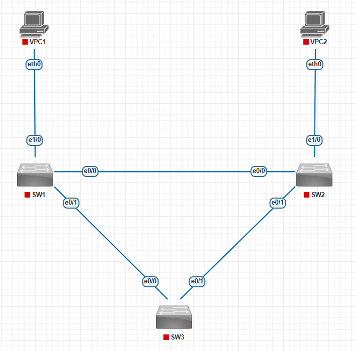

On voit les trois switchs en triangle et les deux PC, chacun relié à un switch différent. Tous les équipements sont démarrés (triangle vert).

Avant de toucher au STP, on vérifie que les deux PC se joignent :

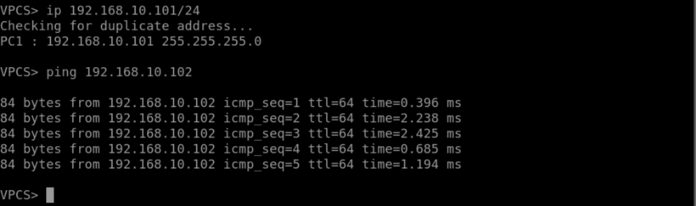

Les 5 pings reviennent : le câblage et l'adressage sont bons, et toute panne observée ensuite viendra bien de ce qu'on teste.

---

## 2. TP1 : STP et RSTP

### 2.1 Démontrer l'effet d'une boucle sans STP

Sur IOL L2, le STP est actif par défaut. Pour montrer le problème qu'il résout, on le désactive sur les 3 switchs :

```
no spanning-tree vlan 1
```
- Désactive le Spanning Tree pour le VLAN 1, le seul VLAN utilisé à ce stade. Plus rien ne casse la boucle du triangle.

Avec la boucle active, on relance le ping entre les deux PC :

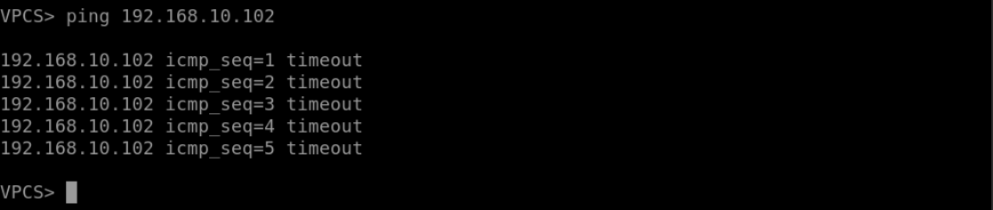

Le ping, qui marchait juste avant, ne passe plus. La première requête ARP (une diffusion, ou *broadcast*) tourne en rond dans le triangle et sature les liens, si bien que les vraies trames n'arrivent plus.

Pour chiffrer la tempête, on regarde le débit d'un port de SW1 alors que personne n'envoie de trafic utile :

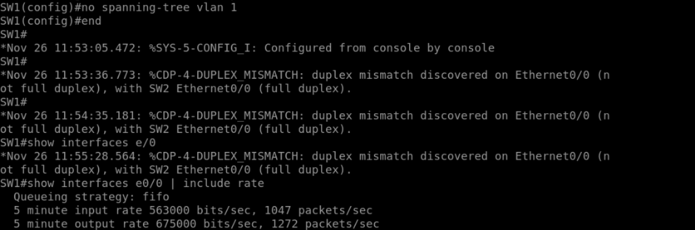

`show interfaces e0/0 | include rate` affiche **1 047 paquets/s en entrée** et **1 272 paquets/s en sortie** sur un seul port. Ce sont les mêmes trames de diffusion recopiées sans fin : une trame Ethernet n'a pas de durée de vie (pas de TTL comme un paquet IP), donc rien ne l'arrête. C'est la **tempête de broadcast**.

### 2.2 Activer STP et choisir le pont racine

On réactive le STP partout et on impose SW1 comme pont racine :

```
spanning-tree vlan 1                    (sur SW1, SW2 et SW3)
spanning-tree vlan 1 priority 4096      (sur SW1 seulement)
```
- `spanning-tree vlan 1` : réactive le STP sur le VLAN 1.
- `priority 4096` : par défaut, tous les switchs ont la priorité 32768. Le pont racine est celui qui a le **Bridge ID le plus petit** (priorité, puis adresse MAC). Avec 4096, SW1 gagne à coup sûr, au lieu d'un switch choisi au hasard par sa MAC. La priorité se règle uniquement par pas de 4096.

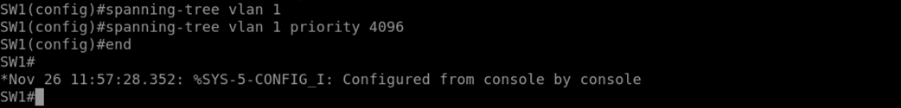

Les deux commandes passent sans erreur sur SW1. SW2 et SW3 ne reçoivent que `spanning-tree vlan 1`.

Trente secondes plus tard, on vérifie l'élection sur SW1 :

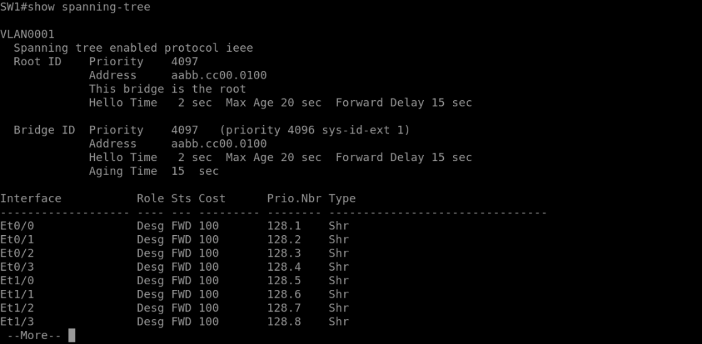

La ligne **« This bridge is the root »** confirme le choix. La priorité affichée est **4097** = 4096 + 1 : Cisco ajoute le numéro du VLAN à la priorité (*extended system ID*, noté `sys-id-ext`). Tous les ports du root sont **Desg FWD**, car un root ne bloque jamais aucun de ses ports.

Puis sur SW2 et SW3, pour remplir le tableau des rôles :

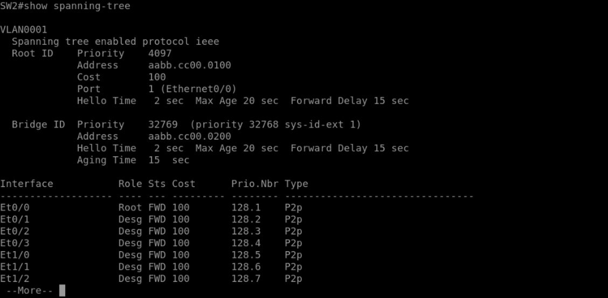

SW2 atteint le root par **Et0/0 (Root FWD)**, au coût 100 ; son port Et0/1, vers SW3, est **Desg FWD**.


SW3 atteint le root par **Et0/0 (Root FWD)**. Son port **Et0/1, vers SW2, est Altn BLK** : c'est le port qui casse la boucle.

### 2.3 Tableau des ports (STP 802.1D)

| Switch | Port | Vers | Rôle | État |
|---|---|---|---|---|
| SW1 (root) | e0/0 | SW2 | Designated | Forwarding |
| SW1 (root) | e0/1 | SW3 | Designated | Forwarding |
| SW2 | e0/0 | SW1 | **Root** | Forwarding |
| SW2 | e0/1 | SW3 | Designated | Forwarding |
| SW3 | e0/0 | SW1 | **Root** | Forwarding |
| SW3 | e0/1 | SW2 | **Alternate** | **Blocking** |

**Pourquoi le port bloqué est sur SW3, et pas sur SW2 ?** SW2 et SW3 sont tous les deux à un coût de 100 du root. Sur le câble SW2–SW3, il faut donc les départager. Le STP prend le **Bridge ID le plus petit** : à priorité égale (32769), c'est la MAC qui tranche. SW2 (`…0200`) a une MAC plus petite que SW3 (`…0300`), donc SW2 garde son port Designated et c'est SW3 qui bloque.

### 2.4 Convergence en STP classique (802.1D)

Test : ping continu de VPC1 vers VPC2 (`ping 192.168.10.102 -t`), puis coupure du lien SW1–SW2 :

```
interface e0/0      (sur SW1)
shutdown
```
- `shutdown` éteint le port, ce qui revient à débrancher le câble SW1–SW2. Le trafic doit alors passer par SW3, dont le port est bloqué.

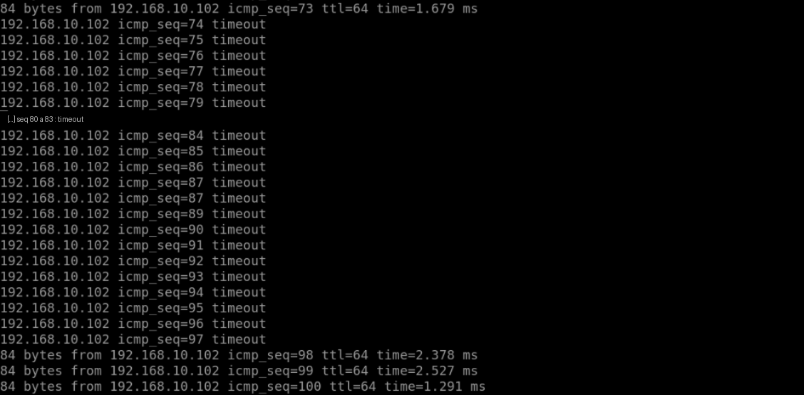

Le ping s'arrête au seq 74 et revient au seq 98, soit **24 timeouts**. Dans VPCS, un timeout prend environ 2 secondes (1 s d'attente de la réponse, puis 1 s avant le ping suivant). La coupure dure donc **environ 48 secondes**, ce qui correspond à la théorie :

| Étape | Durée | Ce qui se passe |
|---|---|---|
| Max Age | 20 s | SW2 ne reçoit plus de BPDU du root et attend que l'info enregistrée expire |
| Listening | 15 s | Le port de SW3 écoute les BPDU pour vérifier qu'il ne crée pas de boucle |
| Learning | 15 s | Le port apprend les adresses MAC, sans encore transmettre |
| **Total** | **≈ 50 s** | Puis le port passe en Forwarding |

(Image composée de deux écrans : les timeouts seq 80 à 83, entre les deux, sont indiqués par une ligne grise.)

### 2.5 Passage en RSTP (rapid-pvst)

```
spanning-tree mode rapid-pvst           (sur SW1, SW2 et SW3)
```
- Passe le switch en **RSTP** (802.1w). Les switchs ne se contentent plus d'attendre des minuteurs : ils se mettent d'accord directement entre voisins (mécanisme *proposal/agreement*). Sur Cisco, `rapid-pvst` veut dire RSTP avec un arbre par VLAN.

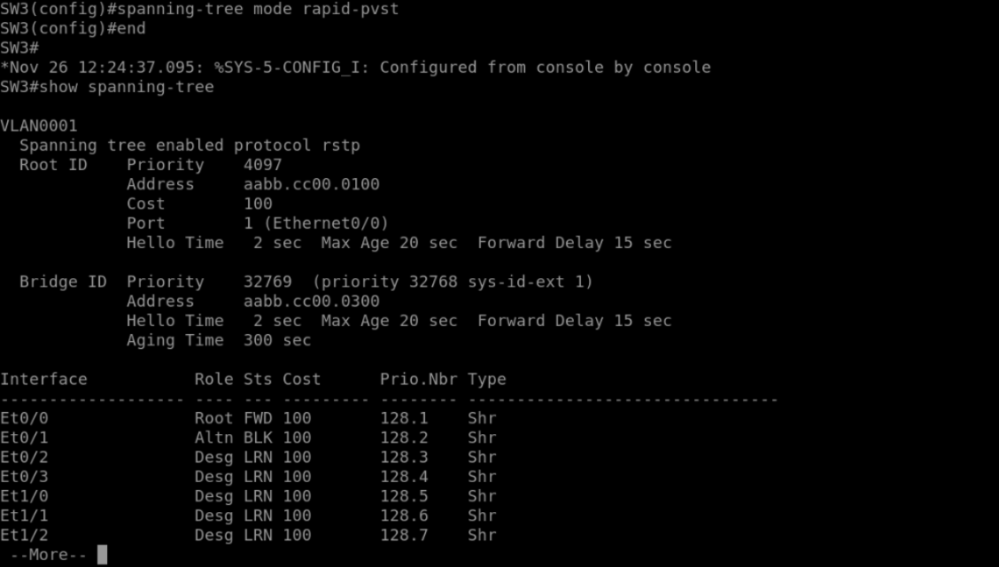

La ligne affiche désormais **`protocol rstp`** au lieu de `ieee`. Mais la colonne **Type** affiche **`Shr`** (lien partagé) sur SW3 : le RSTP n'est rapide que sur un lien **`P2p`** (point à point). Sur un lien partagé, il retombe sur les minuteurs. Les ports en **LRN** (Learning) sur les ports libres en sont le signe. SW1 et SW3 croient leurs liens partagés à cause d'un défaut d'affichage du duplex d'IOL (messages `DUPLEX_MISMATCH`, voir § 7). On corrige à la main sur SW1 et SW3 :

```
interface range e0/0 - 1
spanning-tree link-type point-to-point
```
- `interface range` applique la commande aux 2 ports d'un coup.
- `link-type point-to-point` force le type P2p, ce qui autorise la négociation rapide.

Premier test de coupure en RSTP :

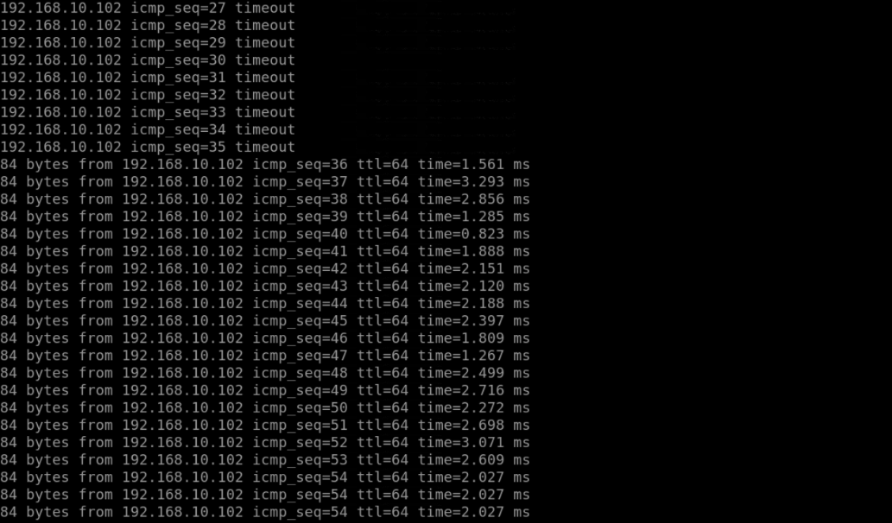

On voit encore au moins 9 timeouts, soit au moins 18 secondes : c'est mieux, mais pas « rapide ». **Cause :** quand SW2 change de chemin, le RSTP bloque un instant tous ses autres ports (étape de synchronisation, *sync*) pour éviter une boucle. Chaque port se rallume dès que le voisin répond « d'accord ». Or le port de SW2 vers **VPC2** n'a personne pour répondre, car un PC ne parle pas STP. Ce port retombe donc sur les minuteurs (15 + 15 s). La solution est de déclarer les ports des PC comme **ports de bordure** (*edge ports*), c'est-à-dire **PortFast** :

```
interface e1/0               (sur SW1 et SW2, ports des PC)
spanning-tree portfast
```
- Le port mène à un PC et non à un switch : il passe en Forwarding tout de suite et n'est jamais bloqué par la synchronisation RSTP. Le switch affiche un avertissement : à ne mettre que sur un port relié à un seul hôte, sinon on risque une boucle.

Même test avec PortFast :

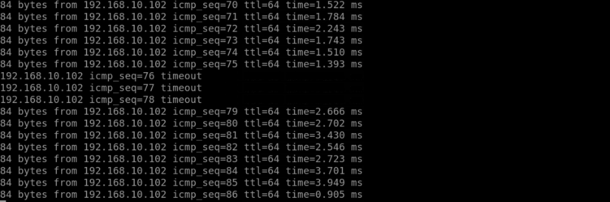

Il n'y a plus que **3 timeouts (seq 76 à 78), soit environ 6 secondes**.

**Pourquoi 6 s et pas moins d'une seconde ?** Dans PNETLab, quand on éteint le port de SW1, SW2 ne voit pas son câble tomber : IOL ne transmet pas la coupure à l'autre bout. SW2 doit donc constater l'absence de **3 BPDU consécutifs** (3 × Hello Time de 2 s = 6 s) avant de réagir. Sur du vrai matériel, le port s'éteint des deux côtés et la bascule RSTP prend moins d'une seconde.

### 2.6 États des ports avant et après la bascule

Après la coupure, on regarde de nouveau SW3 :

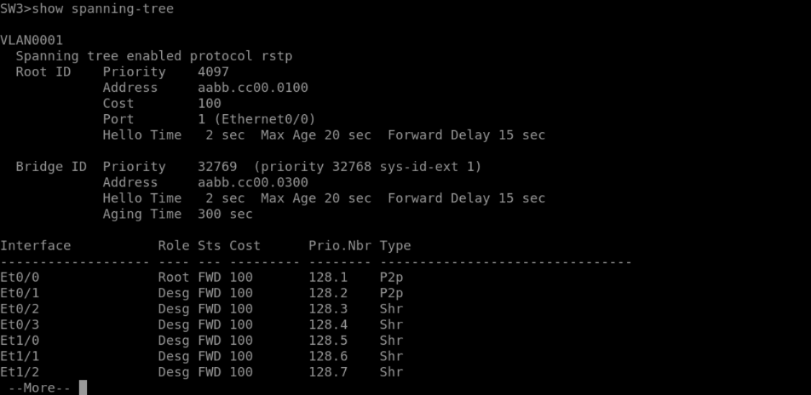

**Et0/1**, qui était **Altn BLK**, est passé **Desg FWD** : le chemin de secours a pris le relais. SW2 atteint maintenant le root en passant par SW3.

| Port de SW3 | Avant la coupure | Après la coupure |
|---|---|---|
| Et0/0 (vers SW1) | Root FWD | Root FWD |
| Et0/1 (vers SW2) | **Altn BLK** | **Desg FWD** |

### 2.7 Relevé des temps de convergence

| Protocole | Réglages | Timeouts | Coupure |
|---|---|---|---|
| STP 802.1D | par défaut | 24 | **≈ 48 s** |
| RSTP | liens `Shr`, sans PortFast | ≥ 9 | ≥ 18 s |
| RSTP | liens `P2p` + PortFast sur les ports PC | **3** | **≈ 6 s** (moins d'une seconde sur du vrai matériel) |

**Différence d'états :** le 802.1D a 5 états (Blocking, Listening, Learning, Forwarding, Disabled). Le RSTP n'en garde que 3 (**Discarding**, Learning, Forwarding) : Blocking, Listening et Disabled ne font rien passer, donc ils sont fusionnés en Discarding. IOS continue d'afficher `BLK` pour un port Discarding. Le RSTP ajoute aussi les rôles **Alternate** (secours vers le root) et **Backup**.

---

## 3. TP2 : Rapid PVST+ et répartition de charge par VLAN

### 3.1 VLAN et trunks

Sur SW1, SW2 et SW3 :

```
vlan 10
vlan 20
interface range e0/0 - 1
switchport trunk encapsulation dot1q
switchport mode trunk
```
- `vlan 10` et `vlan 20` créent les deux VLAN.
- `encapsulation dot1q` choisit la norme 802.1Q pour étiqueter chaque trame avec son numéro de VLAN. IOL gère aussi l'ancien ISL de Cisco, donc il faut préciser la norme avant de passer en trunk.
- `mode trunk` : les liens entre switchs transportent tous les VLAN au lieu d'un seul.

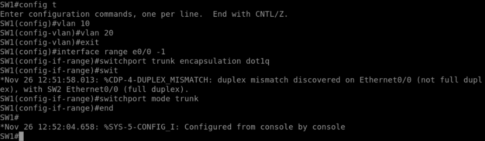

Les commandes passent sans erreur. Les mêmes lignes ont été tapées sur SW2 et SW3.

### 3.2 Un root différent par VLAN

Le principe : SW1 sera root du VLAN 10, SW2 root du VLAN 20, et chacun servira de **root de secours** pour l'autre VLAN (priorité 8192). Sans root de secours, ce serait le switch à la plus petite MAC qui prendrait la place en cas de panne.

```
SW1 :  spanning-tree vlan 10 priority 4096
       spanning-tree vlan 20 priority 8192
SW2 :  spanning-tree vlan 20 priority 4096
       spanning-tree vlan 10 priority 8192
```

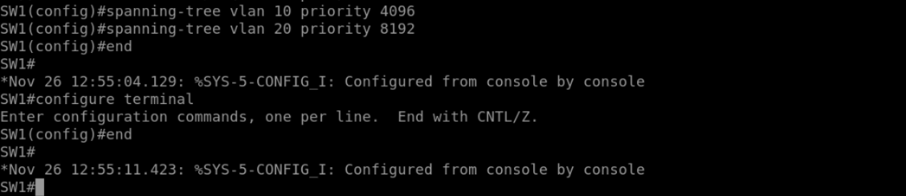

SW1 accepte 4096 pour le VLAN 10 et 8192 pour le VLAN 20.

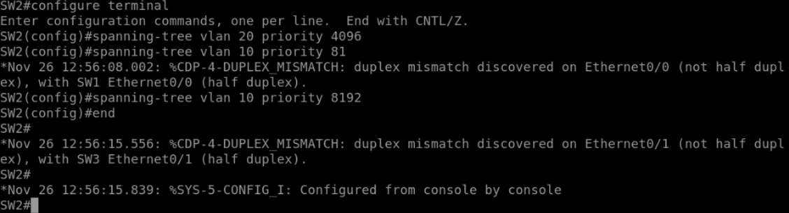

SW2 reçoit les valeurs inverses. On y voit aussi une faute de frappe (`priority 81`), corrigée à la ligne suivante.

### 3.3 Chaque VLAN emprunte un chemin différent

C'est SW3, relié aux deux roots, qui montre le mieux la répartition. VLAN 10 :

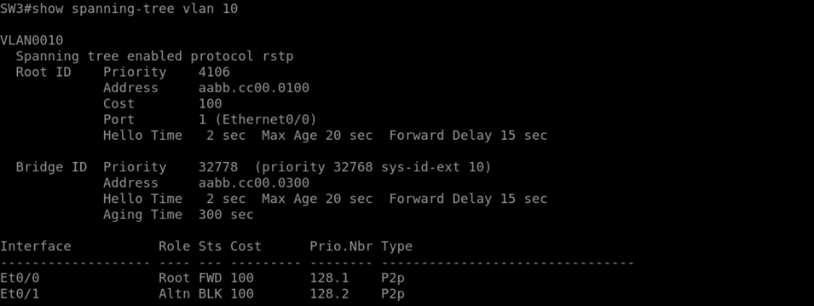

Root = **SW1** (priorité 4106 = 4096 + 10, MAC `…0100`). SW3 l'atteint par **Et0/0 (Root FWD)** ; **Et0/1 est Altn BLK**.

VLAN 20 :

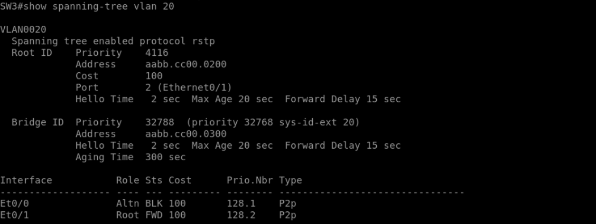

Root = **SW2** (priorité 4116 = 4096 + 20, MAC `…0200`). C'est l'inverse : **Et0/1 est Root FWD** et **Et0/0 est Altn BLK**.

| VLAN | Root (secours) | Port Root de SW3 (FWD) | Port bloqué de SW3 | Lien SW1–SW2 |
|---|---|---|---|---|
| 10 | **SW1** (SW2) | Et0/0 → SW1 | Et0/1 | FWD |
| 20 | **SW2** (SW1) | Et0/1 → SW2 | Et0/0 | FWD |

Les deux câbles de SW3 servent donc tous les deux, chacun pour un VLAN, et aucun lien n'est inutilisé. C'est le **partage de charge** permis par un arbre par VLAN (PVST+). Les PC restent dans le VLAN 1 : la répartition des VLAN 10 et 20 est prouvée par les sorties STP.

### 3.4 Panne du root du VLAN 10

On isole SW1 en éteignant ses deux liens vers les autres switchs, ce qui revient pour le réseau à une panne de SW1 :

```
interface range e0/0 - 1      (sur SW1)
shutdown
```

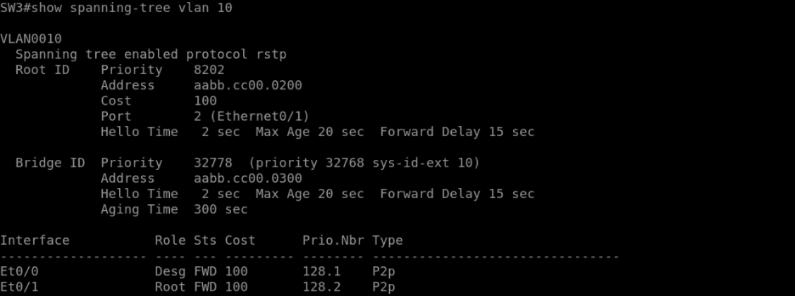

Le nouveau root du VLAN 10 est **SW2** : priorité **8202** (8192 + 10), MAC **`aabb.cc00.0200`**, atteint par **Et0/1**. Le root de secours prévu à l'avance a pris le relais sans aucune action de l'administrateur. Les deux ports de SW3 sont maintenant FWD.

**Méthode pour trouver le root d'un VLAN, sans même taper de commande :**
1. Lister les switchs encore en vie dans ce VLAN (ici SW2 et SW3).
2. Calculer leur priorité : priorité configurée + numéro de VLAN (SW2 : 8192 + 10 = 8202 ; SW3 : 32768 + 10 = 32778).
3. Le plus petit gagne ; en cas d'égalité, c'est la plus petite MAC qui gagne. Ici, SW2.

SW1 a ensuite été rebranché (`no shutdown`).

---

## 4. TP3 : EtherChannel LACP et effet sur STP

### 4.1 Pourquoi un EtherChannel

Si l'on pose 8 câbles entre deux switchs, le STP en bloque 7 pour éviter les boucles : 7 câbles ne servent à rien. Un **EtherChannel** regroupe les câbles en **un seul lien logique** (une interface `Port-channel`). On obtient plus de débit, une tolérance aux pannes, et le STP ne voit qu'un seul lien, donc ne bloque rien. **LACP** (802.3ad) est le protocole standard que les deux switchs utilisent pour négocier ce regroupement ; PAgP est l'équivalent propriétaire Cisco.

### 4.2 Câblage et vérification par CDP

La configuration a d'abord été sauvegardée sur les 3 switchs (`write memory`), car il faut arrêter SW1 et SW2 dans PNETLab pour ajouter des câbles, et une configuration non sauvegardée serait perdue. Huit câbles ont ensuite été tirés entre SW1 et SW2 :

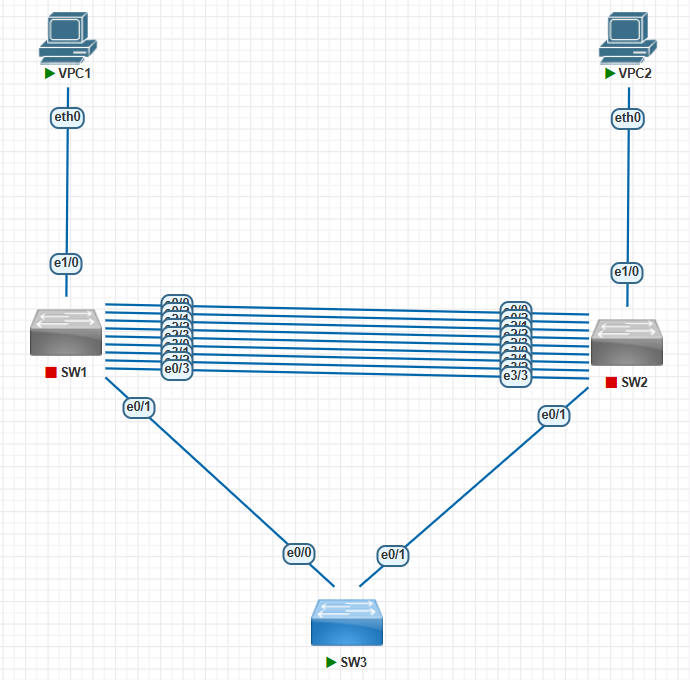

On voit 8 liens entre SW1 et SW2, mais les étiquettes se chevauchent : impossible de vérifier les ports à l'œil. On utilise donc **CDP** (*Cisco Discovery Protocol*), par lequel chaque équipement annonce à ses voisins son nom et son port :

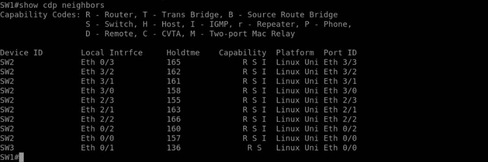

Il y a bien **8 voisins SW2**, mais **2 câbles ne sont pas sur les ports prévus** :

| Prévu | Réellement branché |
|---|---|
| SW1 e2/0 ↔ SW2 e2/0 | SW1 **e0/2** ↔ SW2 **e0/2** |
| SW1 e3/3 ↔ SW2 e3/3 | SW1 **e0/3** ↔ SW2 **e3/3** |

Plutôt que de recâbler, on adapte la liste des ports : un EtherChannel n'exige pas les mêmes numéros de port des deux côtés, seulement que chaque switch regroupe les siens.

### 4.3 Configuration et limite d'IOL

Sur SW1, avec les 8 ports d'abord :

```
interface range e0/2 - 3 , e2/1 - 3 , e3/0 - 2
switchport trunk encapsulation dot1q
switchport mode trunk
channel-group 1 mode active
```
- `channel-group 1` place les ports dans le groupe n°1, ce qui crée l'interface `Port-channel1`.
- `mode active` : le switch **propose** lui-même le regroupement en LACP. En `passive`, il attend qu'on le lui propose. Il faut au moins un côté actif.

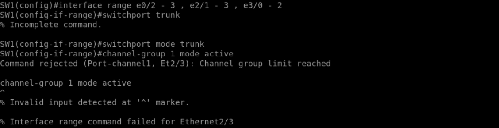

Le switch répond **`Command rejected (Port-channel1, Et2/3): Channel group limit reached`** au 5ᵉ port. L'image IOL L2 accepte **4 ports au maximum** par EtherChannel. Ce n'est pas une erreur de syntaxe : c'est une limite de l'émulateur. Le TP est donc réalisé avec **4 liens agrégés** ; le principe reste le même avec 8. (Une image vIOS-L2 accepterait peut-être plus de membres ; ce n'a pas été testé faute de temps.)

Configuration finale :

```
SW1 :  interface range e2/3 , e3/0 - 2
       shutdown
       interface port-channel 1
       switchport trunk encapsulation dot1q
       switchport mode trunk

SW2 :  interface range e0/2 , e2/1 - 2 , e3/3
       switchport trunk encapsulation dot1q
       switchport mode trunk
       channel-group 1 mode active
       interface port-channel 1
       switchport trunk encapsulation dot1q
       switchport mode trunk
```
- Les 4 câbles non agrégés sont éteints côté SW1. Sinon, le STP les verrait comme des liens séparés et les bloquerait, ce qui fausserait la preuve que le STP ne voit qu'un lien.
- `interface port-channel 1` est le lien logique. On le passe en trunk comme ses membres.

| Membre | SW1 | SW2 |
|---|---|---|
| 1 | Et0/2 | Et0/2 |
| 2 | Et0/3 | Et3/3 |
| 3 | Et2/1 | Et2/1 |
| 4 | Et2/2 | Et2/2 |

### 4.4 Vérification de l'EtherChannel

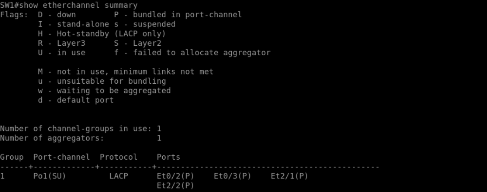

`Po1(SU)` : **S** pour couche 2, **U** pour en service. Les 4 ports sont marqués **(P)**, c'est-à-dire regroupés dans le canal. LACP a bien négocié avec SW2.

### 4.5 Effet sur STP


Trois éléments le montrent :
- **Port 65 (Port-channel1)** est le port Root de SW2 : le STP traite les 4 câbles comme **un seul port**. Aucune ligne Et0/2, Et2/1… n'apparaît pour ces câbles.
- Le **coût est de 41** au lieu de 100 : plus un lien a de débit, plus son coût STP est bas. Le canal va 4 fois plus vite qu'un câble seul, donc le STP le préfère.
- **Et0/0 est passé Altn BLK** : l'ancien câble simple vers SW1 devient le chemin de secours.

(Et2/3 et Et3/0–2 apparaissent FWD côté SW2 parce qu'IOL ne transmet pas l'extinction des ports d'en face. Ils sont éteints côté SW1, donc aucune boucle n'est possible.)

**Analyse courte :** sans EtherChannel, le STP aurait gardé un seul câble actif et bloqué tous les autres. Avec l'EtherChannel, tous les membres transmettent en même temps, et le STP n'a qu'un seul lien logique à gérer.

### 4.6 Panne d'un membre

On coupe Et0/2 sur SW1 pendant un ping continu :

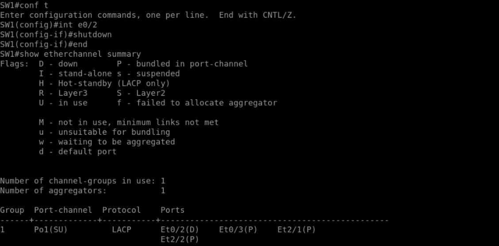

Et0/2 passe en **(D)** (down), les 3 autres restent **(P)** et **Po1 reste (SU)** : le canal fonctionne avec 3 câbles au lieu de 4.

Mais le ping s'interrompt :

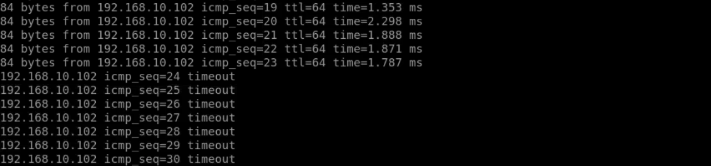

Les timeouts commencent au seq 24. **Cause :** on a éteint Et0/2 côté SW1 seulement, et SW2 ne voit pas son port tomber (même limite d'IOL qu'au TP1). SW2 continue donc à envoyer une partie du trafic, dont les réponses au ping, sur Et0/2, où les paquets sont perdus. LACP finirait par s'en apercevoir, mais seulement après son délai d'expiration (jusqu'à 90 s avec le rythme lent par défaut). Sur du vrai matériel, débrancher un câble éteint le port des deux côtés en même temps. On reproduit donc une vraie coupure en éteignant aussi Et0/2 sur SW2 :

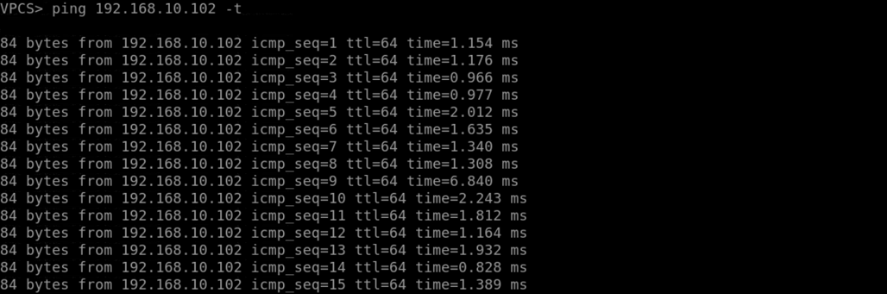

**15 pings sur 15** passent avec 3 câbles sur 4 : le service continue. Côté STP, rien n'a changé : Po1 est toujours debout, donc il n'y a aucun recalcul de l'arbre. Le switch répartit simplement le trafic sur les membres restants.

---

## 5. TP4 : sécurité de la commutation

### 5.1 Schéma des protections par port

```
            VPC1                                     VPC2
              | e1/0 : Port-security (sticky)          | e1/0 : PortFast, port non fiable (DHCP Snooping)
              |        + PortFast + BPDU Guard         |
            [SW1] ---------- Po1 / e0/0 ------------ [SW2] e1/1 : PIRATE (port non fiable)
     e0/1 : Root Guard                                  Po1 : port de confiance (DHCP Snooping)
              \                                        /
               \---------------- [SW3] ---------------/
                       (e0/1 : test BPDU Guard)
```

| Switch | Port | Relié à | Protection(s) | Contre quoi |
|---|---|---|---|---|
| SW1 | e1/0 | VPC1 | Port-security (max 1, sticky, violation restrict), PortFast, **BPDU Guard** | PC non autorisé ; switch branché sur une prise de bureau |
| SW1 | e0/1 | SW3 | **Root Guard** | Switch qui tente de devenir root |
| SW2 | e1/0 | VPC2 | PortFast, port **non fiable** pour DHCP Snooping | Faux serveur DHCP (VPC2 = victime du test) |
| SW2 | e1/1 | PIRATE | Port **non fiable** pour DHCP Snooping | Faux serveur DHCP |
| SW2 | Po1 | SW1 | Port **de confiance** pour DHCP Snooping | (lien vers le cœur du réseau) |
| SW3 | e0/1 | SW2 | BPDU Guard **pour le test uniquement**, retiré ensuite | — |

### 5.2 Port-security : un PC non autorisé

Pour simuler un PC inconnu sans ajouter d'équipement, on déclare sur le port de VPC1 une **autre** adresse MAC comme seule autorisée. VPC1 devient alors le PC non autorisé.

```
interface e1/0                                       (sur SW1)
switchport mode access
switchport port-security maximum 1
switchport port-security mac-address 0000.1111.2222
switchport port-security violation shutdown
switchport port-security
```
- `mode access` : la port-security ne s'applique qu'à un port d'accès, pas à un trunk.
- `maximum 1` : une seule adresse MAC autorisée sur ce port.
- `mac-address 0000.1111.2222` : la MAC autorisée, qui n'est pas celle de VPC1.
- `violation shutdown` : en cas de MAC inconnue, le port se coupe et passe en **err-disabled**.
- `switchport port-security` active la protection. On la met en dernier pour que le switch n'apprenne pas la MAC de VPC1 avant qu'on ait déclaré la MAC autorisée.

Test : VPC1 envoie un ping.

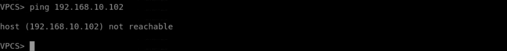

`host (192.168.10.102) not reachable` : VPC1 n'obtient même pas de réponse ARP, car son port a été coupé.

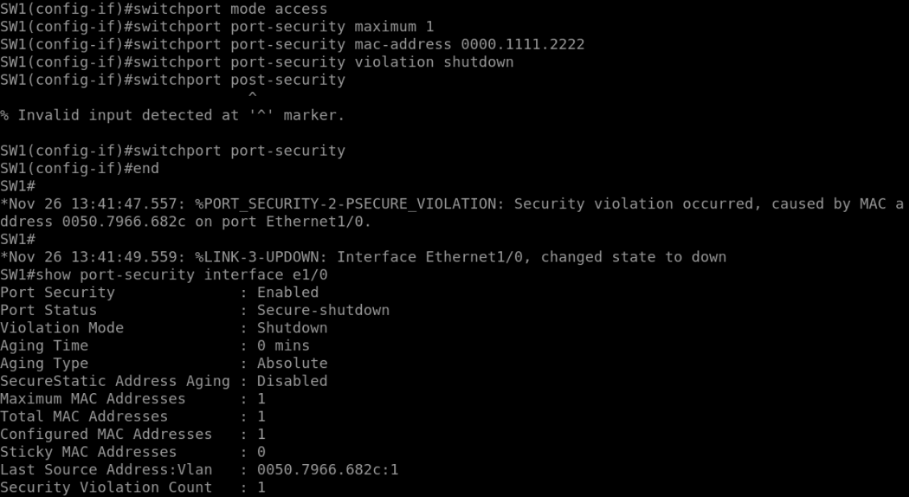

Le log **`%PORT_SECURITY-2-PSECURE_VIOLATION: Security violation occurred, caused by MAC address 0050.7966.682c on port Ethernet1/0`** apparaît, suivi de `Interface Ethernet1/0, changed state to down`. `show port-security interface e1/0` affiche **Port Status : Secure-shutdown**, **Last Source Address : 0050.7966.682c** (la MAC de VPC1) et **Security Violation Count : 1**. Le port non autorisé est bien désactivé.

**Configuration de production, avec retour de VPC1 :**

```
interface e1/0
no switchport port-security mac-address 0000.1111.2222
switchport port-security mac-address sticky
spanning-tree bpduguard enable
shutdown
no shutdown
```
- `mac-address sticky` : le switch **retient tout seul** la MAC du premier PC branché (VPC1), puis refuse toutes les autres. C'est la pratique courante en entreprise.
- `spanning-tree bpduguard enable` : active le BPDU Guard sur ce port de PC (voir § 5.3).
- `shutdown` puis `no shutdown` : c'est le seul moyen de sortir un port de l'état err-disabled.

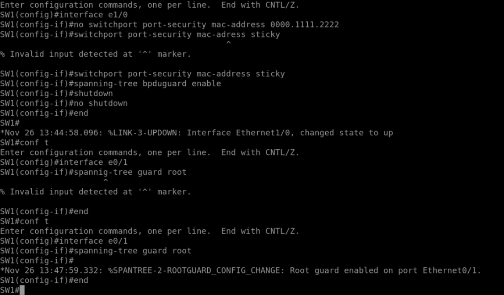

Le port e1/0 repasse **up** (`changed state to up`) : le trafic légitime de VPC1 est rétabli. Plus bas, le Root Guard est activé sur e0/1 (§ 5.4). Les deux fautes de frappe visibles (`mac-adress`, `spannig-tree`) ont été retapées correctement.

### 5.3 BPDU Guard : un switch branché sur une prise de PC

Un port de PC ne doit **jamais** recevoir de BPDU, puisque seuls les switchs en envoient. Le BPDU Guard coupe le port dès qu'il en reçoit un. Il est appliqué sur les ports d'extrémité (`e1/0`). Pour le tester sans recâbler, on l'active temporairement sur **SW3 e0/1**, qui reçoit justement les BPDU de SW2. On simule ainsi quelqu'un qui branche un switch sur une prise prévue pour un PC.

```
interface e0/1                         (sur SW3, test)
spanning-tree bpduguard enable
```

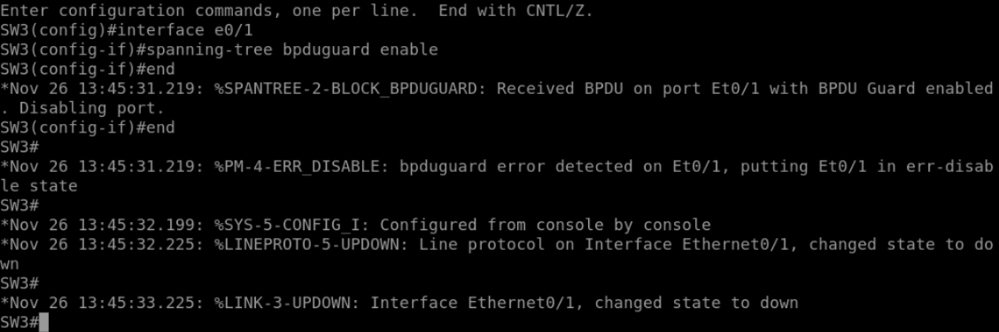

Deux logs apparaissent immédiatement : **`%SPANTREE-2-BLOCK_BPDUGUARD: Received BPDU on port Et0/1 with BPDU Guard enabled. Disabling port.`** puis **`%PM-4-ERR_DISABLE: bpduguard error detected on Et0/1, putting Et0/1 in err-disable state`**. Le port passe ensuite down. Le test a été annulé avec `no spanning-tree bpduguard enable`, puis `shutdown` / `no shutdown`, et le port est revenu up.

### 5.4 Root Guard : un switch qui veut devenir root

Le Root Guard se place sur les ports par lesquels **un root ne doit jamais apparaître**. Sur Cisco, ce sont les ports désignés du root et des switchs de distribution qui descendent vers les switchs d'accès ; c'est ainsi qu'on lit la consigne « ports menant à la racine ». Ici, on l'applique sur **SW1 e0/1**, vers SW3 :

```
interface e0/1                         (sur SW1)
spanning-tree guard root
```
- Si un BPDU « meilleur » (qui annonce un meilleur root) arrive sur ce port, le port est bloqué au lieu de laisser l'arbre se réorganiser.

Attaque simulée : SW3 se donne la priorité la plus basse possible.

```
spanning-tree vlan 1 priority 0        (sur SW3)
```

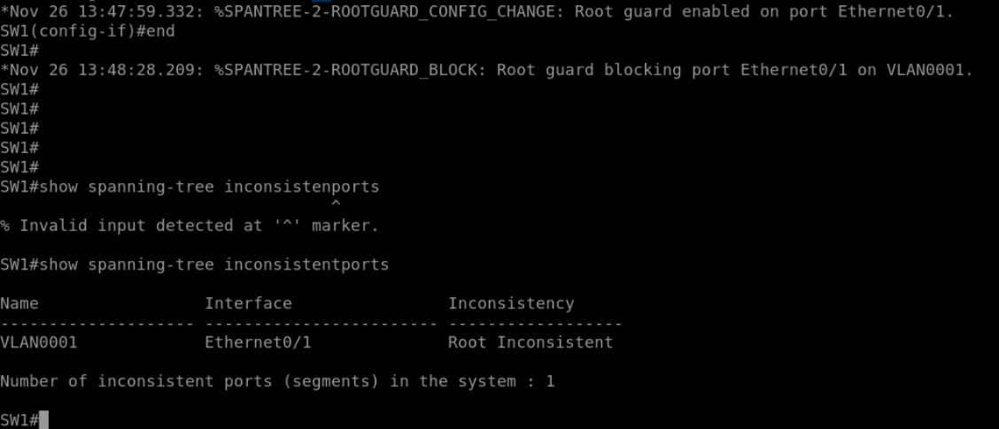

Le log **`%SPANTREE-2-ROOTGUARD_BLOCK: Root guard blocking port Ethernet0/1 on VLAN0001`** apparaît. `show spanning-tree inconsistentports` affiche **VLAN0001 · Ethernet0/1 · Root Inconsistent**. SW1 reste le root choisi par l'administrateur. Contrairement à l'err-disabled, l'état *Root Inconsistent* se lève **tout seul** dès que les BPDU « meilleurs » cessent : l'attaque a été annulée sur SW3 avec `no spanning-tree vlan 1 priority 0`.

### 5.5 DHCP Snooping face à un faux serveur DHCP

**Principe :** un faux serveur DHCP branché sur le réseau peut distribuer de fausses adresses et une fausse passerelle, ce qui fait passer tout le trafic des PC par lui (attaque de l'homme du milieu). Le **DHCP Snooping** classe les ports en **de confiance** (*trusted*, vers les vrais serveurs DHCP et le cœur du réseau) et **non fiables** (*untrusted*, tous les autres). Les réponses DHCP (OFFER, ACK) qui arrivent sur un port non fiable sont jetées.

**Faux serveur** : nœud IOL nommé **PIRATE** (icône routeur), `e0/0` relié à SW2 `e1/1`. Seule l'image IOL L2 était disponible dans PNETLab : on s'en sert comme serveur DHCP grâce à son **interface VLAN** (une adresse IP virtuelle du switch). Pour un attaquant, n'importe quel petit boîtier capable de répondre en DHCP suffit.

```
interface vlan 1                             (sur PIRATE)
ip address 192.168.10.254 255.255.255.0
no shutdown
ip dhcp pool PIRATE
network 192.168.10.0 255.255.255.0
default-router 192.168.10.254
```
- `interface vlan 1` + `ip address` : PIRATE obtient une adresse dans le réseau des PC.
- `ip dhcp pool PIRATE` crée le serveur DHCP ; `network` donne la plage distribuée (adresse **du réseau** + masque, pas une adresse d'hôte).
- `default-router 192.168.10.254` : PIRATE s'annonce comme passerelle. Tout le trafic des victimes vers l'extérieur passerait par lui : c'est l'attaque de l'homme du milieu.

**Avant la protection** : VPC2 demande une adresse avec `ip dhcp`.

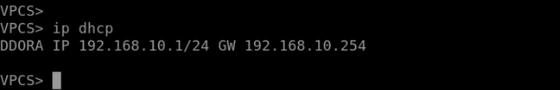

`DDORA IP 192.168.10.1/24 GW 192.168.10.254` : les 4 messages DHCP (Discover, Offer, Request, Ack) ont abouti. VPC2 a accepté l'adresse **et la passerelle du pirate**. L'attaque fonctionne.

**Activation du DHCP Snooping sur SW2 :**

```
ip dhcp snooping
ip dhcp snooping vlan 1
interface port-channel 1
ip dhcp snooping trust
```
- `ip dhcp snooping` active la fonction sur le switch ; `vlan 1` l'applique au VLAN des PC.
- `ip dhcp snooping trust` sur Po1 : le lien vers SW1, côté cœur du réseau, est de confiance. Tous les autres ports, dont **e1/1 (PIRATE)**, restent non fiables par défaut.

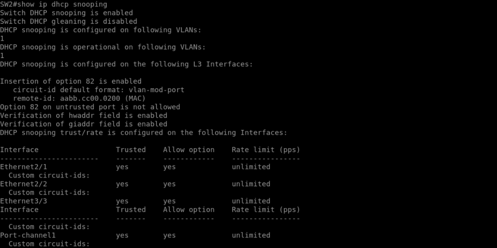

`Switch DHCP snooping is enabled`, et il est `operational` sur le VLAN 1. Les ports **de confiance** sont Po1 et ses membres (Et2/1, Et2/2, Et3/3), qui héritent du réglage du canal. **Et1/1 (PIRATE) n'apparaît pas** dans la liste : il est non fiable.

**Après la protection** : VPC2 refait `ip dhcp`.

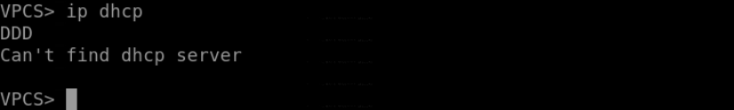

Le premier `ip dhcp` (avant la protection) aboutit (`DDORA`). Le second, après activation du snooping, s'arrête à `DDD` : `Can't find dhcp server`. Les offres du pirate n'arrivent plus.

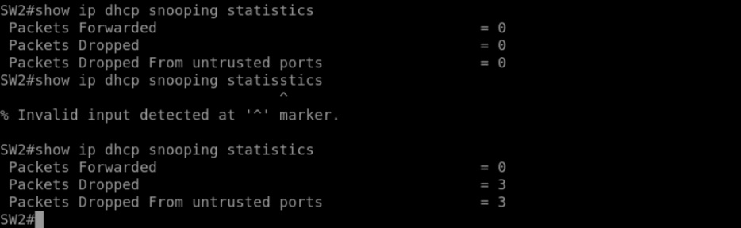

Avant le test : tous les compteurs à 0. Après : **Packets Dropped From untrusted ports = 3**. Ce sont les réponses de PIRATE, jetées par SW2 sur le port non fiable e1/1. Ce compteur prouve que c'est bien le DHCP Snooping qui bloque.

> Remarque : un premier essai depuis VPC1 (branché sur SW1) avait aussi échoué, mais les compteurs de SW2 étaient restés à 0. Ce n'était donc pas une preuve du snooping. Le test a été refait depuis VPC2, sur le même switch que le pirate.

Pour finir, les PC retrouvent leur adresse fixe (`ip 192.168.10.101/24` sur VPC1, `ip 192.168.10.102/24` sur VPC2), puis un ping de contrôle vérifie que le trafic légitime passe toujours avec **toutes** les protections actives :

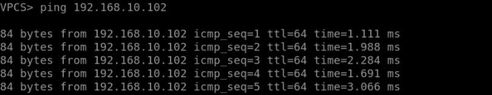

Les réponses reviennent (5/5) : port-security (sticky), BPDU Guard, Root Guard et DHCP Snooping n'empêchent pas le trafic normal.

**Incident avant ce ping final : le sticky avait mémorisé la mauvaise MAC.** Le premier ping de contrôle échouait (`host not reachable`) et le port e1/0 repassait en `err-disabled` à chaque essai. Le message était invisible, car `logging console 3` masque les logs de niveau 4 comme `ERR_DISABLE`. `show running-config interface e1/0` a révélé la cause :

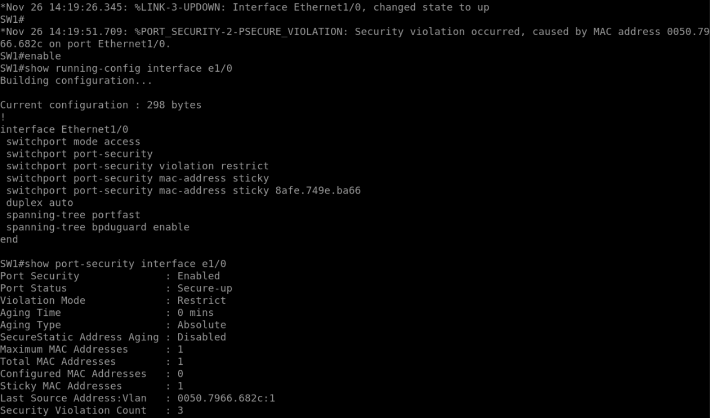

La ligne `switchport port-security mac-address sticky 8afe.749e.ba66` montre que le switch a retenu comme seule adresse autorisée une MAC qui **n'est pas celle de VPC1** (`0050.7966.682c`) : une trame parasite est passée sur le port au moment où le sticky s'est activé. VPC1 était donc traité comme un intrus (Violation Count = 3). Correction en deux temps :
- `switchport port-security violation restrict` : en cas d'intrus, le switch jette ses trames et journalise, mais **ne coupe plus le port** (choix fréquent en entreprise pour ne pas priver un poste de réseau à la moindre alerte) ;
- `no switchport port-security mac-address sticky 8afe.749e.ba66` : on efface l'adresse parasite pour que la MAC de VPC1 soit apprise.

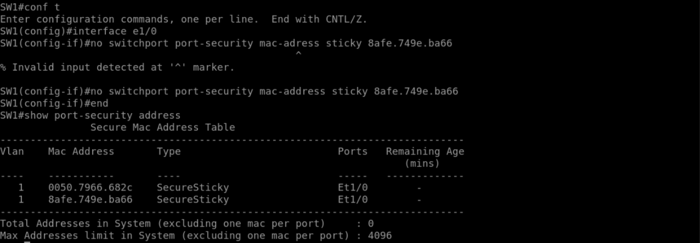

`show port-security address` affiche désormais **0050.7966.682c** (VPC1) en *SecureSticky* sur Et1/0. L'ancienne entrée `8afe.749e.ba66` apparaît encore dans la table juste après la suppression (affichage non rafraîchi par IOL), mais le ping final ci-dessus prouve que VPC1 est bien accepté. Leçon : après avoir activé le sticky, toujours vérifier **quelle** adresse a été retenue avant de considérer le port comme sécurisé.

### 5.6 Tableau de configuration des protections

| Protection | Équipement / port | Commandes | Action en cas de violation | Vérification |
|---|---|---|---|---|
| Port-security | SW1 e1/0 | `switchport port-security` · `maximum 1` · `mac-address sticky` · `violation shutdown` (test) puis `violation restrict` (final) | Test : port err-disabled · Final : trames de l'intrus jetées + log, port conservé | `show port-security interface e1/0` · `show port-security address` |
| PortFast | SW1 e1/0, SW2 e1/0 | `spanning-tree portfast` | — (port de bordure) | `show spanning-tree` (type `Edge`) |
| BPDU Guard | SW1 e1/0 (test : SW3 e0/1) | `spanning-tree bpduguard enable` | Port err-disabled | log `BLOCK_BPDUGUARD` |
| Root Guard | SW1 e0/1 | `spanning-tree guard root` | Port Root Inconsistent (bloqué, se rétablit seul) | `show spanning-tree inconsistentports` |
| DHCP Snooping | SW2 (VLAN 1), Po1 de confiance | `ip dhcp snooping` · `ip dhcp snooping vlan 1` · `ip dhcp snooping trust` | Réponses DHCP jetées sur les ports non fiables | `show ip dhcp snooping` · `show ip dhcp snooping statistics` |

---

## 6. Journal des événements de blocage

| Heure (horloge du lab) | Switch | Message | Signification |
|---|---|---|---|
| 13:41:47 | SW1 | `%PORT_SECURITY-2-PSECURE_VIOLATION: … MAC address 0050.7966.682c on port Ethernet1/0` | MAC non autorisée sur le port de VPC1 |
| 13:41:49 | SW1 | `%LINK-3-UPDOWN: Interface Ethernet1/0, changed state to down` | Port coupé (err-disabled) |
| 13:45:31 | SW3 | `%SPANTREE-2-BLOCK_BPDUGUARD: Received BPDU on port Et0/1 with BPDU Guard enabled. Disabling port.` | BPDU reçu sur un port protégé |
| 13:45:31 | SW3 | `%PM-4-ERR_DISABLE: bpduguard error detected on Et0/1, putting Et0/1 in err-disable state` | Port coupé |
| 13:47:59 | SW1 | `%SPANTREE-2-ROOTGUARD_CONFIG_CHANGE: Root guard enabled on port Ethernet0/1.` | Root Guard activé |
| 13:48:28 | SW1 | `%SPANTREE-2-ROOTGUARD_BLOCK: Root guard blocking port Ethernet0/1 on VLAN0001.` | Tentative de prise de root bloquée |
| — (compteur) | SW2 | `show ip dhcp snooping statistics` : **Packets Dropped From untrusted ports = 3** | Offres DHCP du pirate jetées sur e1/1 |

---

## 7. Problèmes rencontrés

| Problème | Cause | Solution / leçon |
|---|---|---|
| La VM PNETLab refuse de démarrer (erreur `hv.capable`) après avoir coché « Virtualize Intel VT-x » | Hyper-V est actif sur l'hôte Windows : VMware ne peut pas exposer la virtualisation imbriquée | Case décochée. Les nœuds IOL n'ont pas besoin de VT-x |
| La console « native » de PNETLab n'ouvre rien | Elle dépend d'un programme client absent du PC | Déconnexion, puis reconnexion en choisissant la **console HTML5** (dans le navigateur) |
| SW3 créé en vIOS Switch, différent des autres | Le lab du formateur utilisait des **IOL L2** | SW3 supprimé et recréé en IOL L2 (Ethernet = 4 groupes de 4 ports), pour des sorties et des commandes identiques sur les 3 switchs |
| `config t` refusé : `% Invalid input` | Session revenue en **mode utilisateur** (`SW2>`) après une inactivité | `enable` pour repasser en mode privilégié (`#`). En labo : `line console 0` / `exec-timeout 0 0` pour désactiver la déconnexion automatique (à ne pas faire en production) |
| Commandes coupées par des messages `%CDP-4-DUPLEX_MISMATCH` | Défaut d'IOL sur le duplex annoncé par CDP, sans effet réel | `logging console 3` : seuls les messages de gravité 0 à 3 s'affichent dans la console. `no cdp log mismatch duplex` n'existe pas sur cette image IOL |
| Liens vus `Shr` (partagés) en RSTP | Même défaut de duplex : un lien half-duplex est considéré comme partagé | `spanning-tree link-type point-to-point` |
| RSTP lent (≥ 18 s) au premier essai | Ports des PC non déclarés edge : ils subissent la synchronisation RSTP avec les minuteurs | `spanning-tree portfast` sur les ports des PC |
| Coupure d'un port invisible de l'autre côté (TP1 et TP3) | IOL ne propage pas l'état du lien au voisin | Au TP1, convergence de 6 s (3 hellos manqués) au lieu de moins d'une seconde. Au TP3, couper les **deux** côtés pour simuler un vrai débranchement |
| 2 câbles sur de mauvais ports au TP3 | Étiquettes illisibles lors du câblage dans PNETLab | Détecté avec `show cdp neighbors` ; liste des ports adaptée au lieu de recâbler |
| `Channel group limit reached` au 5ᵉ port | Limite de l'image IOL L2 : 4 ports par EtherChannel | TP3 fait avec 4 liens agrégés, et les 4 câbles restants éteints |
| Fautes de frappe (`spannig-tree`, `mac-adress`, `termnial`…) | Saisie rapide | Le `^` d'`% Invalid input` montre l'endroit exact de l'erreur ; il faut toujours relire l'invite et la réponse du switch |
| Ping final impossible, port e1/0 en `err-disabled` à répétition | Le sticky avait mémorisé une MAC parasite (`8afe.749e.ba66`) au lieu de celle de VPC1 | Diagnostic avec `show running-config interface e1/0` ; MAC parasite supprimée et violation passée en `restrict`. Toujours vérifier `show port-security address` après un sticky |
| `show` ou `interface` refusés | Mauvais mode (`#` au lieu de `(config)#`, ou l'inverse) | Regarder l'invite avant chaque commande ; `do show …` permet d'utiliser `show` depuis le mode config |

---

## 8. Tableau de validation

| TP | Critère de l'énoncé | Résultat | Preuve |
|---|---|---|---|
| 1 | Le pont racine est celui attendu | ✅ SW1 (priorité 4096) | tp1-03 |
| 1 | Reprise de service après coupure d'un lien | ✅ STP ≈ 48 s, RSTP ≈ 6 s | tp1-06, tp1-08, tp1-09 |
| 2 | Chaque VLAN a un pont racine distinct | ✅ VLAN 10 = SW1, VLAN 20 = SW2 | tp2-01, tp2-02 |
| 2 | Aucun lien redondant inutilisé sans raison | ✅ Les 2 liens de SW3 servent chacun un VLAN | tp2-01, tp2-02 |
| 2 | Reconvergence après panne du root | ✅ SW2 devient root du VLAN 10 (8202) | tp2-03 |
| 3 | Canal actif avec tous ses membres | ✅ Po1(SU), 4/4 membres (P) ; 8 liens impossibles sur IOL | tp3-02, tp3-02a |
| 3 | STP voit un seul lien | ✅ Po1 Root FWD, coût 41 | tp3-03 |
| 3 | La panne d'un membre n'interrompt pas le service | ✅ 15/15 pings avec 3 membres | tp3-04, tp3-05 |
| 4 | Ports non autorisés désactivés ou bloqués | ✅ Port-security, BPDU Guard, Root Guard, DHCP Snooping | tp4-00 à tp4-06 |
| 4 | Le trafic légitime n'est pas affecté | ✅ VPC1 revenu avec la config sticky ; ping final VPC1 → VPC2 OK | tp4-07, tp4-07b |

---

## 9. À retenir (fiche de révision)

- **Élection du root** : le plus petit Bridge ID gagne (priorité + n° de VLAN, puis MAC). On impose le root avec `spanning-tree vlan X priority 4096` (par pas de 4096) et on prévoit un root de secours (8192).
- **Port bloqué** : sur un lien entre deux non-root, à coût égal, c'est le switch au Bridge ID le plus grand qui bloque.
- **802.1D ≈ 50 s** (Max Age 20 + Listening 15 + Learning 15) ; **RSTP < 1 s** sur du vrai matériel, à condition d'avoir des liens **P2p** et des ports PC en **PortFast** (edge).
- **Rapid PVST+** : un arbre par VLAN, ce qui permet de répartir la charge en choisissant un root différent par VLAN.
- **EtherChannel LACP** : `channel-group N mode active` ; le STP ne voit qu'un port `Po` au coût plus bas ; la perte d'un membre ne déclenche aucun recalcul de l'arbre.
- **Toujours vérifier le câblage** avec `show cdp neighbors`.
- **Sécurité L2** :
  - port-security `sticky` + `violation shutdown` sur les ports d'accès ;
  - PortFast + BPDU Guard sur les ports PC ;
  - Root Guard là où le root ne doit pas apparaître ;
  - DHCP Snooping avec `trust` seulement vers le cœur du réseau et les vrais serveurs.
- **Sortir de err-disabled** : `shutdown` puis `no shutdown` (après avoir corrigé la cause). Root Inconsistent se lève tout seul.
- **Lire l'invite** : `>` utilisateur, `#` privilégié, `(config)#` configuration. Sauvegarder avec `write memory` avant tout arrêt d'un équipement.
